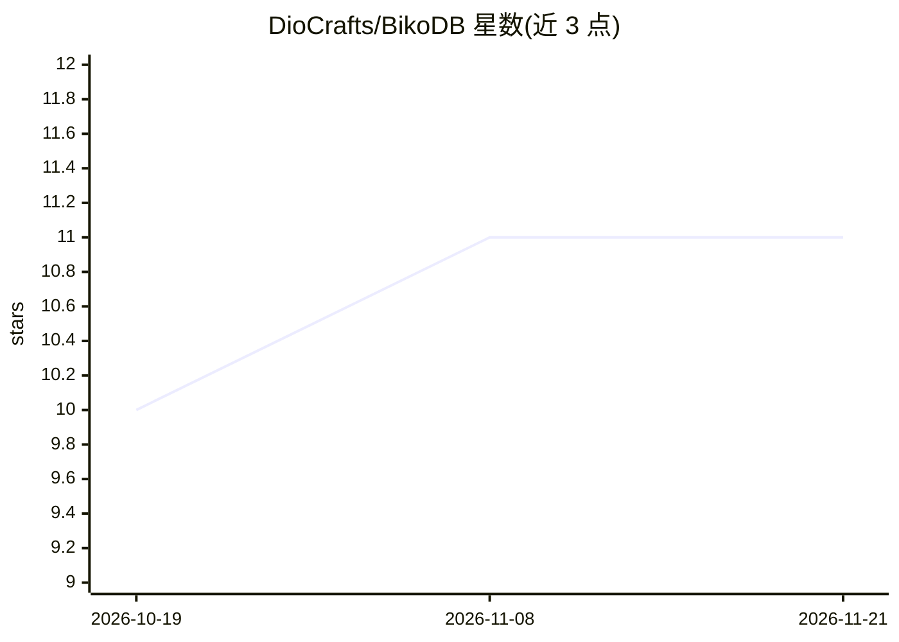

# DioCrafts/BikoDB

⭐ 11 · Rust · 推送 2026-04-23 · [GitHub](https://github.com/DioCrafts/BikoDB) · 组织维护

**Rust 编写的多模型知识图谱数据库，供查询图/文档/向量数据**

BikoDB 是一个 Rust workspace，组合并发图引擎、文档存储、HNSW 向量搜索，以及 SQL/Cypher/Gremlin 子集查询解析器，通过内嵌 Database API 提供服务。README 明确各模块成熟度：图核心与算法、内嵌 API、读子集、文档存储为 Stable；向量搜索、HTTP 路由、Python/Node 绑定、集群为 Experimental；Docker 打包部署为 Planned。主查询调度器目前面向读操作，SQL/Cypher 写入未作为完成特性提供。

## 筛选速览

| 维度 | 判定 | 备注 |
|---|---|---|
| AI 角色 | `ai-enhanced` | 去掉 AI 部分产品仍成立 |
| 许可风险 | `none` | — |
| 部署形态 | `library` | 以包/库形式分发 |
| 模型依赖 | — | README 未给出锁定关系 |
| 硬件要求 | — | 无带数字的原话,不猜 |
| 安装摩擦 | `low` | 无编译、无系统依赖或容器化 |
| 成熟度 | `idea` | |

## 能力要点

- 单一代码库内组合图、文档、向量三种模型，桥接方法互通
- 支持 SQL/Cypher/Gremlin 的文档化读子集
- 包含 PageRank 等 11 种图算法与 HNSW 向量索引
- 提供内嵌 Rust Database API 与 Python/Node 绑定

## 适用场景

- 在 Rust 应用中嵌入图数据存储与查询
- 用 Cypher/Gremlin/SQL 子集查询图数据
- 对图数据运行 PageRank 等图算法
- 在图引擎中配合向量索引做 AI 相关检索实验

## 场景标签

`知识图谱` `向量数据库` · 领域:知识与检索

## 证据(README 行号)

> L3:  Multi-model graph runtime in Rust for graph, document, and vector workloads.
> L33: - HNSW-based vector search,
> L48: |HNSW vector search|Experimental|Real and usable, but part of a broader evolving AI surface|

## 星数曲线

2026-10-19 10 → 2026-11-21 11（+1）

---
*卡片 v1 · prompt 1.4 · 生成 2026-11-19 · 置信度 mid · 依据 README sha `42c840197477` · [字段定义](../../DATASET.md)*
