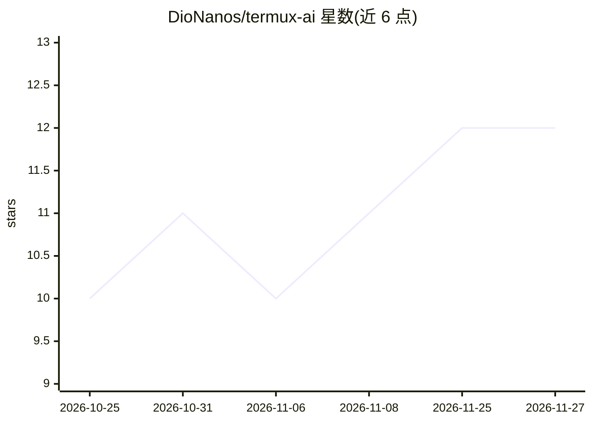

# DioNanos/termux-ai

⭐ 12 · Java · NOASSERTION · 推送 2026-11-23 · [GitHub](https://github.com/DioNanos/termux-ai) · 个人维护

**面向 AI CLI 工作流优化的 Android Termux 终端构建**

基于 Termux Classic 线的 Android 终端应用重新打包，保持原生 Termux 环境（apt 包管理、target SDK 28），增加面向手机上运行 AI CLI 工具的兼容层：多工作区隔离 $HOME、改进键盘麦克风输入、提供 termux-ai 命令输出 JSON 格式的 Android 上下文、内置部分 Termux:API 兼容命令、免伴侣应用的启动脚本。通过 GitHub release 分发按架构签名的 APK。

## 筛选速览

| 维度 | 判定 | 备注 |
|---|---|---|
| AI 角色 | `ai-enhanced` | 去掉 AI 部分产品仍成立 |
| 许可风险 | `none` | NOASSERTION |
| 部署形态 | `None` |  |
| 模型依赖 | — | README 未给出锁定关系 |
| 硬件要求 | — | 无带数字的原话,不猜 |
| 安装摩擦 | `low` | 无编译、无系统依赖或容器化 |
| 成熟度 | — | 结构信号不足 |

## 能力要点

- 单安装多工作区：共享原生 $PREFIX，各自独立 $HOME，无 proot
- termux-ai 命令以 JSON 输出 Android 上下文供 AI CLI 调用
- 内置 Wave 1 Termux:API 兼容命令（TTS、toast 等），不需单独伴侣应用
- BOOT_COMPLETED 后直接在活动工作区运行启动脚本

## 适用场景

- 在 Android 手机终端里运行 Codex、Gemini CLI、Qwen Code 等 AI CLI 工具
- 在同一台设备上为不同项目维护隔离的开发工作区
- 让 AI CLI 读取设备上下文并调用 Android 设备功能

## 场景标签

 · 领域:开发工具/终端

## 证据(README 行号)

> L3: > Optimized Termux Classic build for **AI CLI workflows on Android**.
> L4: > It keeps the normal Termux environment and adds a small compatibility layer for
> L74: - **multi-user workspaces**: multiple isolated `$HOME`s over one shared native base (see above)

## 星数曲线

2026-10-25 10 → 2026-11-27 12（+2）

---
*卡片 v1 · prompt 1.4 · 生成 2026-11-19 · 置信度 high · 依据 README sha `a62bdfad8975` · [字段定义](../../DATASET.md)*
