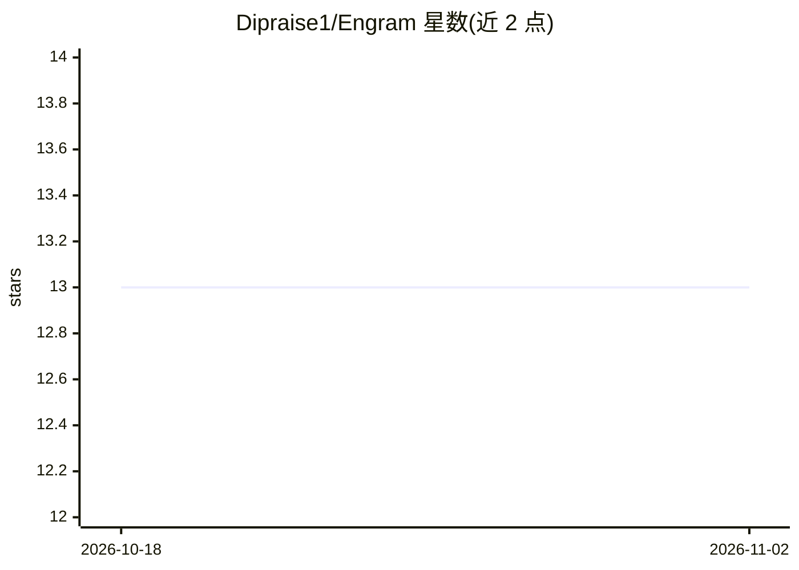

# Dipraise1/Engram

⭐ 13 · Python · MIT · 推送 2026-07-13 · [GitHub](https://github.com/Dipraise1/Engram) · [官网](https://theengram.space) · 个人维护

**基于 Bittensor 的去中心化向量数据库，为 AI 提供内容寻址语义记忆**

运行于 Bittensor 子网 450 的去中心化向量存储：将文本、图像、PDF 嵌入后生成确定性 CID，由竞争性矿工多副本存储，二进制文件经 Arweave 永久保存；矿工通过 HMAC 挑战-响应证明存储与检索行为以赚取 TAO。提供 Python SDK、CLI、LangChain VectorStore 集成与网页 Playground；私有命名空间采用 X25519 加密与差分隐私噪声。面向需要去中心化 RAG 记忆层的开发者和希望挖矿获取激励的参与者；可自建矿工/验证者或经 Akash 手机端托管挖矿。当前运行于 Bittensor 测试网。

## 筛选速览

| 维度 | 判定 | 备注 |
|---|---|---|
| AI 角色 | `ai-ecosystem` | LLM/agent 周边工具 |
| 许可风险 | `permissive` | MIT |
| 部署形态 | `self-host` | docker 或自建部署 |
| 模型依赖 | — | README 未给出锁定关系 |
| 硬件要求 | — | 无带数字的原话,不猜 |
| 安装摩擦 | `low` | 无编译、无系统依赖或容器化 |
| 成熟度 | — | 结构信号不足 |

## 能力要点

- 内容寻址 CID：同一内容映射到同一标识符，跨矿工一致
- 矿工经 HMAC 挑战-响应与 Merkle 承诺验证存储，赚取 TAO
- 图像/PDF 双 CID 架构，原始文件经 Arweave 永久存储
- X25519 混合加密 + 差分隐私噪声（ε=3.0）保护私有命名空间

## 适用场景

- 为 RAG 应用提供无单一故障点的语义记忆存储
- 通过 LangChain VectorStore 接入现有检索链路
- 运行矿工节点参与 Bittensor 激励网络赚取 TAO
- 手机经 Akash 托管节点按小时 USDC 付费挖矿

## 场景标签

`向量数据库` `RAG` · 领域:知识与检索

## 证据(README 行号)

> L22: Engram is a Bittensor subnet that turns text, images, and documents into **permanently stored, content-addressed me
> L32: > **Why does this matter?** Every RAG system today relies on a single-vendor vector database (Pinecone, Weaviate, p
> L168: from engram.sdk.langchain import EngramVectorStore

## 星数曲线

2026-10-18 13 → 2026-11-02 13（+0）

---
*卡片 v1 · prompt 1.4 · 生成 2026-11-01 · 置信度 high · 依据 README sha `e8d597c84a6d` · [字段定义](../../DATASET.md)*
