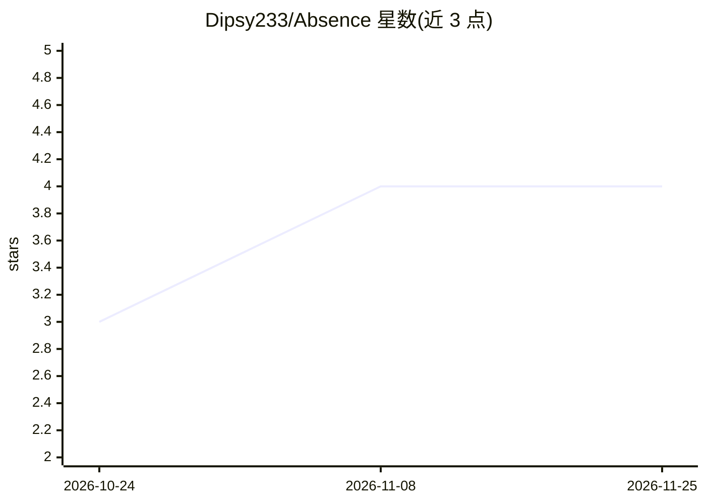

# Dipsy233/Absence

⭐ 4 · TypeScript · MIT · 推送 2026-11-06 · [GitHub](https://github.com/Dipsy233/Absence) · 个人维护 · 中文 README

**AI agent 实时可视化观察器：看它做什么并留存可回放的记录**

通过 ACP 协议连接已安装的 agent，实时渲染其正在执行的动作（文件读写、diff、命令输出、审批请求、MCP 调用），并提供三界面视图（Rounds/Monitor/Chart）与 0.25×–10× 回放。报告的归约在 Web 客户端完成，不使用 LLM、不解析命令文本。会话归档于 SQLite，支持按事件流与状态快照重建运行。需 Node.js 22.19+ 且主机上已装至少一个 agent（本体不捆绑 agent 运行时）；服务器无自带认证，建议置于反向代理之后。

## 筛选速览

| 维度 | 判定 | 备注 |
|---|---|---|
| AI 角色 | `ai-ecosystem` | LLM/agent 周边工具 |
| 许可风险 | `permissive` | MIT |
| 部署形态 | `desktop` | 安装包/桌面程序 |
| 模型依赖 | — | README 未给出锁定关系 |
| 硬件要求 | — | 无带数字的原话,不猜 |
| 安装摩擦 | `low` | 无编译、无系统依赖或容器化 |
| 成熟度 | — | 结构信号不足 |

## 能力要点

- 七种 ACP profile 以纯数据方式声明，可添加任意自定义 ACP 可执行入口
- Absence Report 在客户端归约事件，无需 LLM 参与
- 每 25 个事件或 5 秒取快照，支持 0.25×–10× 回放
- 资源指标覆盖 agent 进程树、子进程、Docker 容器与主机，持久化到 SQLite

## 适用场景

- 观察 agent 编码过程中的文件改动与命令执行
- 回放并核查一次 agent 运行留下的进程与未完成的审批
- 同时管理多个 agent（Codex/Claude Code/Qwen Code/Gemini 等）的运行

## 场景标签

 · 领域:开发者工具/agent 可观测性

## 证据(README 行号)

> L9: Absence is a real-time visual observer for AI agents. It connects to an agent, shows what the agent is doing while i
> L20: Absence shows a live agent in three switchable faces, Rounds, Monitor and Chart, with Drip as an overlay that repea

## 星数曲线

2026-10-24 3 → 2026-11-25 4（+1）

---
*卡片 v1 · prompt 1.4 · 生成 2026-11-21 · 置信度 high · 依据 README sha `bdad16aa6a32` · [字段定义](../../DATASET.md)*
