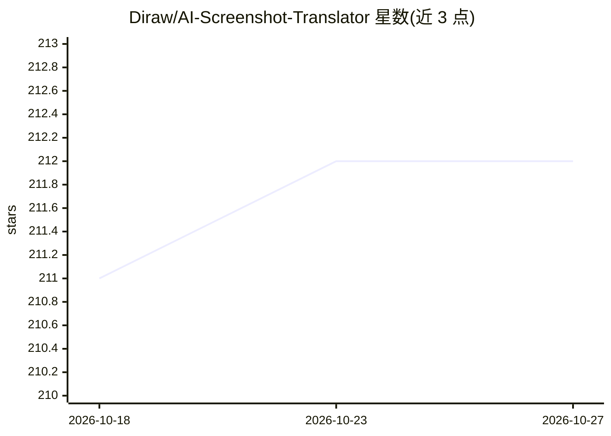

# Diraw/AI-Screenshot-Translator

⭐ 212 · C · GPL-3.0 · 推送 2026-05-16 · [GitHub](https://github.com/Diraw/AI-Screenshot-Translator) · 个人维护 · 中文 README

**Windows 截图 AI 翻译与归档工具，面向论文阅读者**

基于 Qt 6 + WebView2 的 Windows 桌面工具：全局快捷键截图后调用 AI Provider（OpenAI/Gemini/Claude，可扩展，提示词可自定义、支持代理）翻译为富文本结果，支持 Markdown、代码高亮与 LaTeX 公式渲染。结果窗口支持翻页、编辑、查看原图与标签；归档窗口按日期/标签筛选与批量操作，历史存于本地 JSON 与图片目录。提供多配置文件、连通性测试与调试日志。仅支持 Windows，Release 包可直接运行或经 CMake + MSVC + Qt 6 自行构建，WebView2 Runtime 需单独确认安装。

## 筛选速览

| 维度 | 判定 | 备注 |
|---|---|---|
| AI 角色 | `ai-native` | 本体是模型或模型工具 |
| 许可风险 | `viral` | GPL-3.0 |
| 部署形态 | `desktop` | 安装包/桌面程序 |
| 模型依赖 | locked-api |  |
| 硬件要求 | — | 无带数字的原话,不猜 |
| 安装摩擦 | `medium` | 含编译或系统依赖之一 |
| 成熟度 | — | 结构信号不足 |

## 能力要点

- 截图→AI 翻译→Markdown/代码高亮/LaTeX 富文本结果
- 支持 OpenAI / Gemini / Claude Provider，提示词与代理可配置
- 归档管理：日期/标签筛选、批量操作、本地历史存储
- 多配置文件（导入/导出/复制）与连通性测试

## 适用场景

- 阅读论文时截图翻译含数学公式的内容
- 处理扫描版 PDF 等无法复制文本的资料
- 翻译结果按标签归档并事后筛选管理

## 场景标签

 · 领域:科研阅读/翻译工具

## 证据(README 行号)

> L9: - 截图 → AI 翻译 → 富文本结果（Markdown/代码高亮/LaTeX）
> L27: - AI Provider：OpenAI / Gemini / Claude（可扩展），提示词可自定义，支持代理

## 星数曲线

2026-10-18 211 → 2026-10-27 212（+1）

---
*卡片 v1 · prompt 1.4 · 生成 2026-10-22 · 置信度 high · 依据 README sha `79787f98f752` · [字段定义](../../DATASET.md)*
