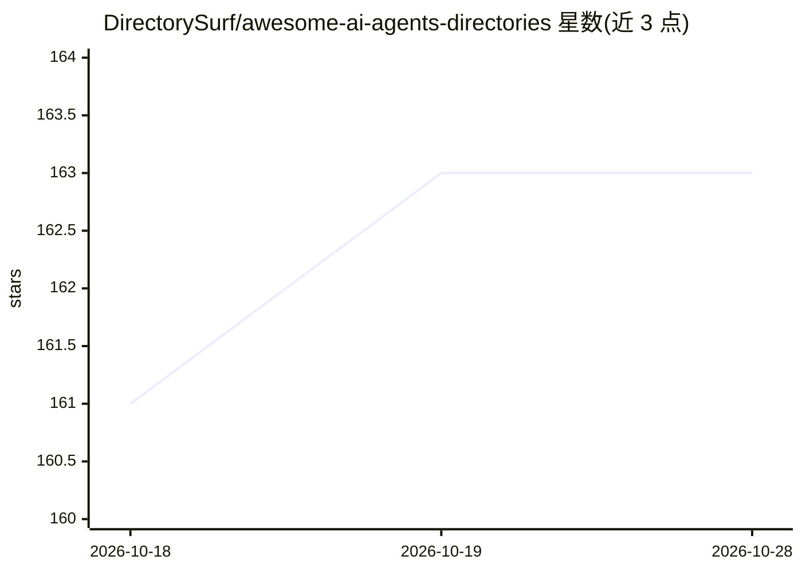

# DirectorySurf/awesome-ai-agents-directories

⭐ 163 · MIT · 推送 2026-09-09 · [GitHub](https://github.com/DirectorySurf/awesome-ai-agents-directories) · 个人维护

**AI agent 目录站与仓库的策展清单**

一个 awesome-list 形式的清单仓库，收录线上 AI agent 目录网站（含 Altern、AI Agent Store 等集市/对比平台）与 GitHub 上的相关策展仓库（如 awesome-ai-agents、awesome-llm-apps 等），按目录站和 GitHub 仓库两类组织。面向需要发现、评估 AI agent 与平台的开发者、研究者与创业者，内容以条目加简介的形式呈现，接受 PR 贡献。

## 筛选速览

| 维度 | 判定 | 备注 |
|---|---|---|
| AI 角色 | `ai-knowledge` | 知识聚合/清单类 |
| 许可风险 | `permissive` | MIT |
| 部署形态 | `None` |  |
| 模型依赖 | — | README 未给出锁定关系 |
| 硬件要求 | — | 无带数字的原话,不猜 |
| 安装摩擦 | `low` | 无编译、无系统依赖或容器化 |
| 成熟度 | — | 结构信号不足 |

## 能力要点

- 收录线上 AI agent 目录/集市网站条目
- 收录 10 个 GitHub 策展仓库条目
- 接受 PR 贡献补充新条目

## 适用场景

- 寻找可提交自己 agent 产品的目录站
- 了解 AI agent 生态的发现与对比平台
- 查找更多 agent 相关的 awesome 清单

## 场景标签

`精选清单` · 领域:学习与行业

## 证据(README 行号)

> L1: # Awesome AI Agent Directories
> L3: A comprehensive list of the best AI agent directories available online. This curated collection includes websites an
> L5: ## AI Agents Directories

## 星数曲线

2026-10-18 161 → 2026-10-28 163（+2）

---
*卡片 v1 · prompt 1.4 · 生成 2026-10-22 · 置信度 high · 依据 README sha `c3814de8bbc0` · [字段定义](../../DATASET.md)*
