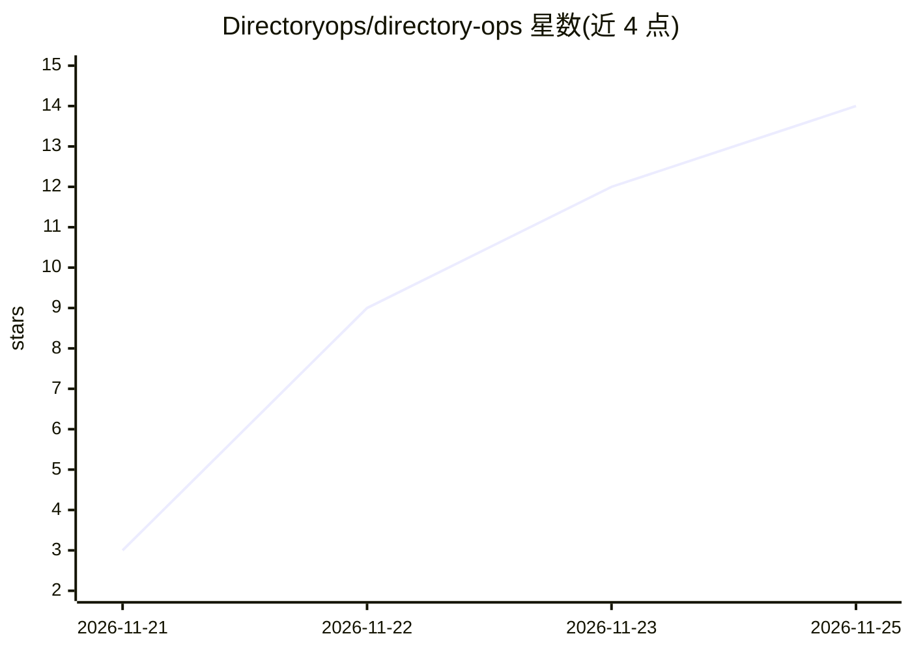

# Directoryops/directory-ops

⭐ 14 · Python · MIT · 推送 2026-11-18 · [GitHub](https://github.com/Directoryops/directory-ops) · 个人维护

**目录网站 AI 员工技能包：维持信息准确、产出引流内容、分发线索**

运行于 Hermes Agent（托管在 Hostinger）之上的技能与操作手册集合，面向目录网站运营者。包含 11 个定时运行的 helper：核验商家营业时间与联系方式、从 Reddit 提取客户关注点补充列表页、整理站内邮件为待批准修改、撰写 SEO 文章与内链建议、抓取死链与重复标题、转发线索给商家。工作流先出方案由用户逐项挑选，所有改动需用户批准且记录旧值可回滚。安装为在 Hermes 聊天中粘贴 INSTALL.md 消息，约 2 分钟。

## 筛选速览

| 维度 | 判定 | 备注 |
|---|---|---|
| AI 角色 | `ai-ecosystem` | LLM/agent 周边工具 |
| 许可风险 | `permissive` | MIT |
| 部署形态 | `None` |  |
| 模型依赖 | — | README 未给出锁定关系 |
| 硬件要求 | — | 无带数字的原话,不猜 |
| 安装摩擦 | `low` | 无编译、无系统依赖或容器化 |
| 成熟度 | — | 结构信号不足 |

## 能力要点

- 11 个 helper 覆盖列表核验、内容撰写、SEO 检查与线索转发
- 改动需用户批准，每次修改记录旧值可撤销
- 列表数据支持 Supabase、GitHub 数据文件、Google Sheets、Airtable
- 代码修改以可粘贴的 Claude Code 提示词或给开发者的指令交付

## 适用场景

- 自动核对目录站里商家的营业时间与关闭状态
- 为城市/分类页重写引言并生成内链建议
- 把站内报价请求路由给合适商家并跟进

## 场景标签

`AI 写作` `网页抓取` `AI 助手` · 领域:效率与自动化

## 证据(README 行号)

> L6: It runs on **Hermes Agent** (an AI assistant you host on Hostinger), you talk to it in plain English, and **it asks 
> L16: You install it once, say **"Onboard a site"**, and Hermes:
> L25: ||Helper|What it does for you|How often|

## 星数曲线

2026-11-21 3 → 2026-11-25 14（+11）

---
*卡片 v1 · prompt 1.4 · 生成 2026-11-22 · 置信度 high · 依据 README sha `c692634c95a4` · [字段定义](../../DATASET.md)*
