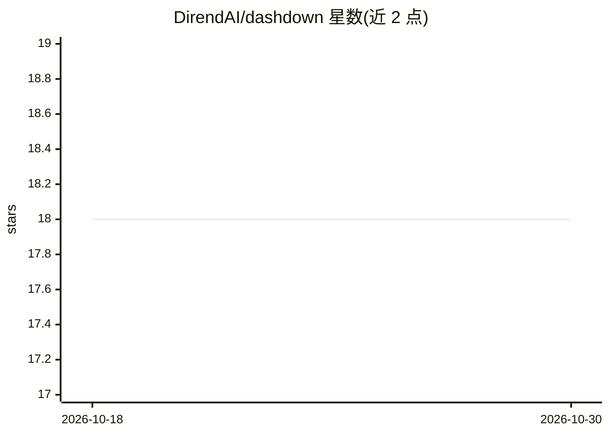

# DirendAI/dashdown

⭐ 18 · Python · AGPL-3.0 · 推送 2026-07-24 · [GitHub](https://github.com/DirendAI/dashdown) · [官网](https://direndai.github.io/dashdown/) · 组织维护

**用 Markdown+SQL 生成交互式分析仪表盘的 Python 工具**

面向数据分析和 BI 场景的开发者工具：在 .md 文件中写 SQL 与组件标签（Counter、各类 XChart、表格、筛选器），CLI 即可启动热重载的开发服务器并渲染为浏览器中的交互式仪表盘，无需编写 JavaScript 或前端构建链。支持 CSV/Parquet/DuckDB/PostgreSQL/Snowflake/BigQuery 等多种数据源，可静态导出 HTML、生成 PDF。AI 为可选功能：Ask 组件渲染模型对数据的解读（Mistral/Claude/OpenAI/OpenRouter），图表可生成带标注的 AI 解说；并为编码代理（Claude Code、Cursor 等）提供 AGENTS.md 技能与内省命令。核心以 pip 包分发，许可为 AGPL-3.0-or-later。

## 筛选速览

| 维度 | 判定 | 备注 |
|---|---|---|
| AI 角色 | `ai-enhanced` | 去掉 AI 部分产品仍成立 |
| 许可风险 | `viral` | AGPL-3.0 |
| 部署形态 | `library` | 以包/库形式分发 |
| 模型依赖 | — | README 未给出锁定关系 |
| 硬件要求 | — | 无带数字的原话,不猜 |
| 安装摩擦 | `low` | 无编译、无系统依赖或容器化 |
| 成熟度 | — | 结构信号不足 |

## 能力要点

- Markdown+SQL+组件标签即成完整仪表盘，零 JavaScript
- 支持 14+ 种数据连接器，可静态导出 HTML 与 PDF
- Ask 组件与图表 AI 解说（含服务端校验的图上标注）
- 为编码代理提供 AGENTS.md、技能目录与 check/query/screenshot 等验证命令

## 适用场景

- 用 Markdown 快速搭建带 KPI、图表与筛选器的数据仪表盘
- 让编码代理按 PR diff 方式生成和修改仪表盘
- 把数据仪表盘静态导出托管到 Netlify/GitHub Pages

## 场景标签

`数据分析` · 领域:效率与自动化

## 证据(README 行号)

> L17: Write a `.md` file with some SQL and a few component tags. Dashdown serves it as a
> L78: - **LLM commentary** — `<Ask data={q} ask="What stands out?" />` renders a

## 星数曲线

2026-10-18 18 → 2026-10-30 18（+0）

---
*卡片 v1 · prompt 1.4 · 生成 2026-10-29 · 置信度 high · 依据 README sha `149907d08f85` · [字段定义](../../DATASET.md)*
