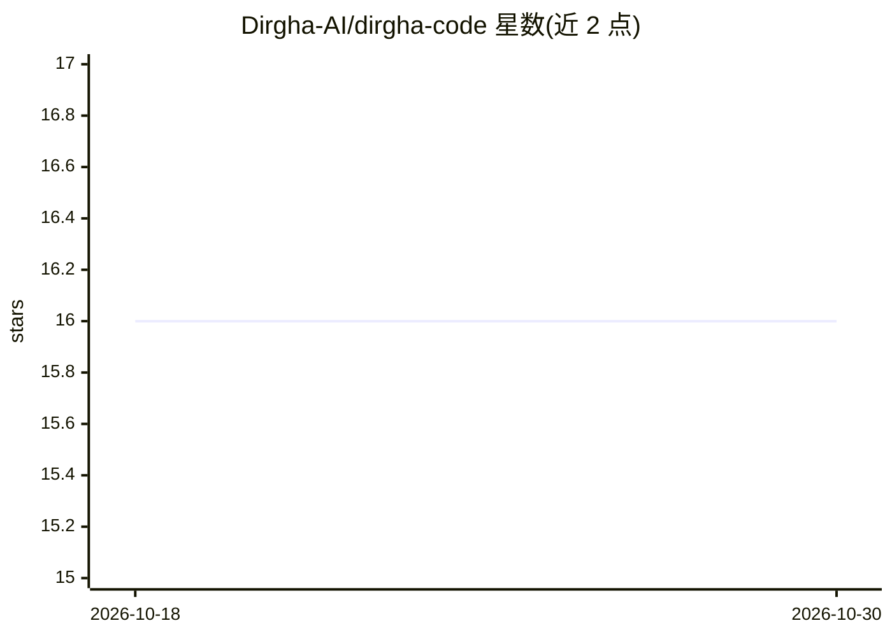

# Dirgha-AI/dirgha-code

⭐ 16 · TypeScript · NOASSERTION · 推送 2026-08-01 · [GitHub](https://github.com/Dirgha-AI/dirgha-code) · [官网](https://dirgha.ai) · 组织维护

**开源终端 AI 编码代理：BYOK 多提供商，支持本地模型离线运行**

面向开发者的命令行编码代理，可读取代码库、编辑文件、运行测试、提交并审计每步操作。支持 17 个提供商自带密钥接入，含 Anthropic/OpenAI/Gemini 等，并对 llama.cpp 与 Ollama 提供本地运行支持，可完全离线使用。机制上提供多密钥池轮换、4 级故障转移级联、四层持久记忆（审计日志/记忆/账本/知识库）、并行子代理 fleet 与 MCP 支持。第三方技能包在安装与加载时经启发式注入/供应链扫描。许可证为 FSL-1.1-MIT（两年后转 MIT）。

## 筛选速览

| 维度 | 判定 | 备注 |
|---|---|---|
| AI 角色 | `ai-native` | 本体是模型或模型工具 |
| 许可风险 | `none` | NOASSERTION |
| 部署形态 | `library` | 以包/库形式分发 |
| 模型依赖 | local-ok | 支持本地模型 |
| 硬件要求 | — | 无带数字的原话,不猜 |
| 安装摩擦 | `low` | 无编译、无系统依赖或容器化 |
| 成熟度 | — | 结构信号不足 |

## 能力要点

- 17 个提供商 BYOK 接入，多密钥池轮换与 429 冷却
- llama.cpp / Ollama 本地模型一等支持，可离线运行
- dirgha fleet 并行代理：git worktree 隔离、多方案评审、DAG 链式执行
- 四层持久记忆含 TF-IDF 检索账本与 docs 知识库编译

## 适用场景

- 在终端里让 AI 读取代码库、改文件、跑测试并开 PR
- 用自己的 API key 或本地 Ollama/llama.cpp 模型做编码助手
- 并行派发多个子代理处理分解后的独立任务

## 场景标签

`编码 Agent` `多智能体` · 领域:Agent 开发

## 证据(README 行号)

> L8: **Dirgha Code is the open-source CLI coding agent — 17 providers, BYOK, offline-capable, parallel agents, persistent
> L20: A terminal coding assistant that reads your codebase, edits files, runs tests, commits, and audits every step. It r
> L26: First-class llama.cpp and Ollama support. The setup wizard auto-probes `localhost:8080` and `localhost:11434`, list

## 星数曲线

2026-10-18 16 → 2026-10-30 16（+0）

---
*卡片 v1 · prompt 1.4 · 生成 2026-10-30 · 置信度 high · 依据 README sha `f4233d7dd32b` · [字段定义](../../DATASET.md)*
