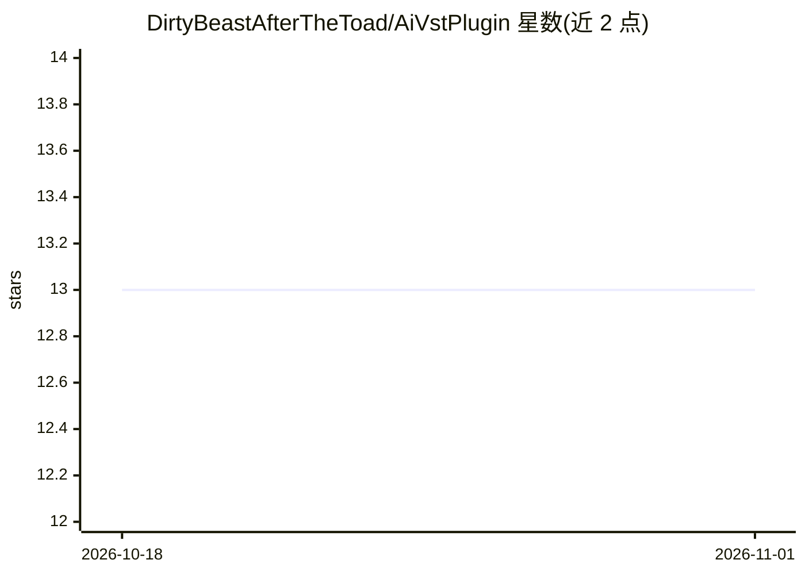

# DirtyBeastAfterTheToad/AiVstPlugin

⭐ 13 · C++ · 推送 2026-01-08 · [GitHub](https://github.com/DirtyBeastAfterTheToad/AiVstPlugin) · 个人维护

**在 DAW 内调用 AI 音乐模型的 VST3 插件（C++）**

用 C++ 和 Projucer 构建的 VST3 乐器插件，从 DAW 内部直接调用 Facebook Research Audiocraft（MusicGen）等音乐生成模型生成采样。运行依赖外部 Python 环境：Anaconda、audiocraft、PyTorch 2.1.0（Windows 带 CUDA 12.1）与 ffmpeg。作者自述当前模型多数时候倾向生成完整音乐而非可用采样，TODO 列表含 UI、采样修改等功能。安装方式为将仓库内 .vst3 文件复制到 DAW 插件目录，Mac 流程未经验证。

## 筛选速览

| 维度 | 判定 | 备注 |
|---|---|---|
| AI 角色 | `ai-native` | 本体是模型或模型工具 |
| 许可风险 | `none` | — |
| 部署形态 | `library` | 以包/库形式分发 |
| 模型依赖 | — | README 未给出锁定关系 |
| 硬件要求 | — | 无带数字的原话,不猜 |
| 安装摩擦 | `medium` | 含编译或系统依赖之一 |
| 成熟度 | `idea` | |

## 能力要点

- VST3 乐器插件，在 DAW 内直接生成 AI 音乐采样
- 调用 Audiocraft/MusicGen 模型，通过 Generate.py 可改系统提示词
- Windows 提供带 CUDA 12.1 支持的 PyTorch 安装流程
- 提供 .vst3 文件直接安装，无需自行编译

## 适用场景

- 音乐制作人在 DAW 内直接生成 AI 采样素材
- 调整系统提示词以影响生成结果
- Projucer 打开 .jucer 工程修改插件本身

## 场景标签

 · 领域:音频制作/AI 音乐生成

## 证据(README 行号)

> L3: This project is a VST plugin created using C++ and Projucer.
> L16: - Audiocraft: A library developed by Facebook Research for high-quality audio synthesis and music generation.
> L96: Once you have followed the setup instructions, you can take the `.vst3` file from the `/VST` directory and install 

## 星数曲线

2026-10-18 13 → 2026-11-01 13（+0）

---
*卡片 v1 · prompt 1.4 · 生成 2026-10-31 · 置信度 mid · 依据 README sha `33cb0e6f764e` · [字段定义](../../DATASET.md)*
