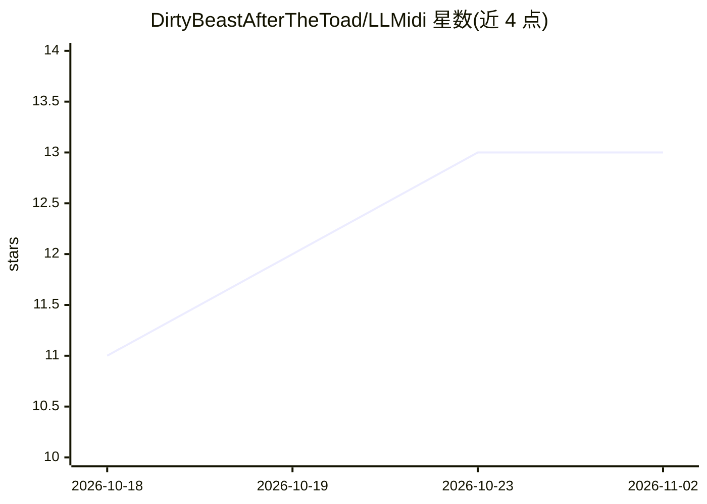

# DirtyBeastAfterTheToad/LLMidi

⭐ 13 · C++ · 推送 2025-12-06 · [GitHub](https://github.com/DirtyBeastAfterTheToad/LLMidi) · [官网](https://rallem.com/llmidi) · 个人维护

**用 LLM 从自然语言生成 MIDI 音乐模式的 VST3 插件**

基于 JUCE 的 VST3 插件，将自然语言提示（如“E 小调钢琴旋律”）解析为事件 JSON 并实时调度 MIDI 播放。提供两种模式：离线模式（仅 Windows）通过内嵌 llama.cpp 加载本地 GGUF 模型，为每个模型建立持久缓存加速后续生成；在线模式（Windows/macOS）通过复制提示到任意网页聊天机器人（ChatGPT、Claude、Gemini 等）再粘贴回 JSON 输出导入。Windows 可从 releases 下载编译好的 VST3，macOS 需从源码构建且仅支持在线模式；Logic Pro 因不支持 VST3 无法使用。

## 筛选速览

| 维度 | 判定 | 备注 |
|---|---|---|
| AI 角色 | `ai-native` | 本体是模型或模型工具 |
| 许可风险 | `none` | — |
| 部署形态 | `desktop` | 安装包/桌面程序 |
| 模型依赖 | local-ok | 支持本地模型 |
| 硬件要求 | — | 无带数字的原话,不猜 |
| 安装摩擦 | `low` | 无编译、无系统依赖或容器化 |
| 成熟度 | — | 结构信号不足 |

## 能力要点

- 离线模式内嵌 llama.cpp 后端运行本地 GGUF 模型
- 在线模式复用任意网页聊天机器人，无需本地模型
- 按模型持久化 .session 缓存加速重复生成
- 生成的 MIDI 可录制/渲染进 FL Studio、Ableton 等 DAW

## 适用场景

- 在 DAW 里用一句话生成旋律或鼓点模式快速找灵感
- 本地离线运行 GGUF 模型生成 MIDI，不上传网络
- 借助大规模在线模型生成复杂和声进行

## 场景标签

 · 领域:音乐制作/AI 音频工具

## 证据(README 行号)

> L3: **LLMidi** is a JUCE-based VST3 plugin that generates musical MIDI patterns using large language models (LLMs).
> L6: - **Offline mode (Windows only)** – Use a local `GGUF` model through an embedded `llama.cpp` backend.
> L17: into playable MIDI patterns, either through a local LLM (offline) or a chatbot interface (online).

## 星数曲线

2026-10-18 11 → 2026-11-02 13（+2）

---
*卡片 v1 · prompt 1.4 · 生成 2026-10-31 · 置信度 high · 依据 README sha `2e9195f84221` · [字段定义](../../DATASET.md)*
