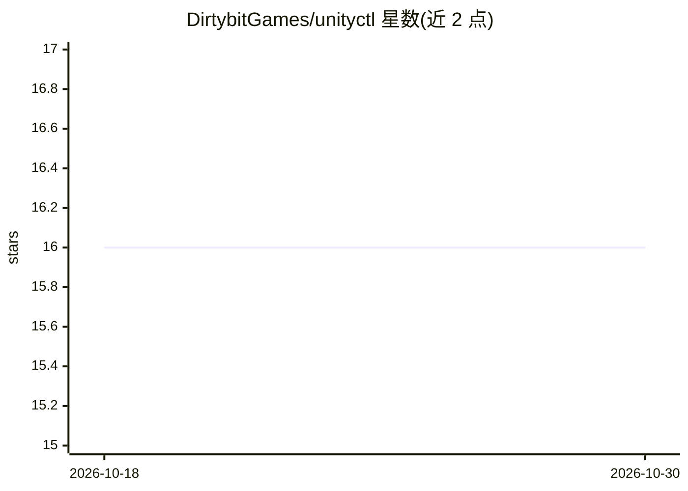

# DirtybitGames/unityctl

⭐ 16 · C# · MIT · 推送 2026-06-22 · [GitHub](https://github.com/DirtybitGames/unityctl) · 组织维护

**供 AI agent 远程操控 Unity 编辑器的 CLI 工具**

CLI + bridge 守护进程 + Unity 插件三层架构：CLI 经 HTTP 连接 bridge，bridge 经 WebSocket 连接编辑器插件，bridge 在 Unity domain reload 后存活。支持刷新资源触发编译并回显错误、进入/退出 play mode、截图、读取日志、执行任意 C# 脚本或 .cs 文件，以及场景加载、测试运行、菜单执行、插件扩展等命令。面向用 Claude Code 等 agent 在 Unity 中工作的开发者，setup 时安装 Claude Code skill 供按需查阅。需 .NET 10 SDK，MIT 许可。

## 筛选速览

| 维度 | 判定 | 备注 |
|---|---|---|
| AI 角色 | `ai-ecosystem` | LLM/agent 周边工具 |
| 许可风险 | `permissive` | MIT |
| 部署形态 | `None` |  |
| 模型依赖 | — | README 未给出锁定关系 |
| 硬件要求 | — | 无带数字的原话,不猜 |
| 安装摩擦 | `medium` | 含编译或系统依赖之一 |
| 成熟度 | — | 结构信号不足 |

## 能力要点

- CLI/bridge/Unity 插件三层架构，bridge 在 domain reload 后存活
- script eval/execute 可在编辑器内执行任意 C# 代码
- play mode 控制、截图与日志读取供 agent 观察运行状态
- 脚本/可执行文件两类插件扩展自定义命令

## 适用场景

- 让 Claude Code 等 agent 直接编辑并编译 Unity C# 脚本
- agent 驱动编辑器运行游戏、截图与读日志做视觉确认
- 通过插件机制为 agent 添加项目专属的 Unity 操作命令

## 场景标签

 · 领域:游戏开发/开发工具

## 证据(README 行号)

> L3: Let AI agents drive the Unity Editor. Edit scripts, compile, play, screenshot, debug—all from the command line.
> L143: There are MCP servers for Unity, but they eat a lot of context window for any task that doesn't require driving th

## 星数曲线

2026-10-18 16 → 2026-10-30 16（+0）

---
*卡片 v1 · prompt 1.4 · 生成 2026-10-30 · 置信度 high · 依据 README sha `842cb526ac40` · [字段定义](../../DATASET.md)*
