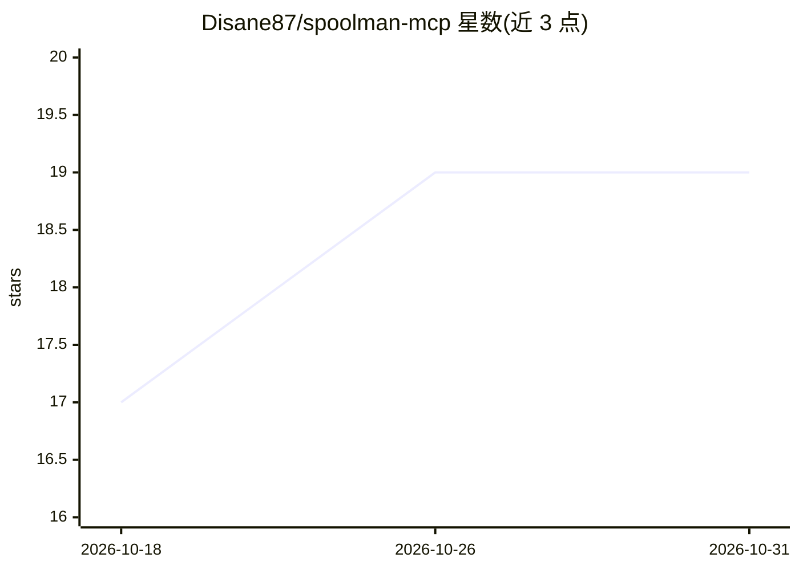

# Disane87/spoolman-mcp

⭐ 19 · TypeScript · MIT · 推送 2026-08-15 · [GitHub](https://github.com/Disane87/spoolman-mcp) · [官网](https://blog.disane.dev) · 个人维护

**连接 AI 助手与 Spoolman 的 MCP 服务器：用自然语言管理 3D 打印耗材**

基于 TypeScript 的 Model Context Protocol 服务器，将自托管 Spoolman 实例的 REST API v1 封装为 MCP 工具，供 Claude Desktop / Claude Code 等 AI 助手调用，覆盖厂商、线材、料盘的增删改查、用量记录、称重更新、设置读写、自定义字段、查询与 JSON/CSV 导出。运行前提：Node.js ≥18、npm ≥9，以及一个已运行的本地/自托管 Spoolman 实例；通过环境变量 SPOOLMAN_URL（必填）与 SPOOLMAN_API_KEY（可选）配置。安装方式为 git clone 后 npm install/build，MIT 许可。

## 筛选速览

| 维度 | 判定 | 备注 |
|---|---|---|
| AI 角色 | `ai-ecosystem` | LLM/agent 周边工具 |
| 许可风险 | `permissive` | MIT |
| 部署形态 | `library` | 以包/库形式分发 |
| 模型依赖 | — | README 未给出锁定关系 |
| 硬件要求 | — | 无带数字的原话,不猜 |
| 安装摩擦 | `low` | 无编译、无系统依赖或容器化 |
| 成熟度 | — | 结构信号不足 |

## 能力要点

- 覆盖 Spoolman REST API v1 的全部端点：厂商/线材/料盘/设置/自定义字段/查询/导出/系统
- 按重量或长度记录线材消耗，支持称重更新剩余量
- 导出数据为 JSON 或 CSV，支持触发 SQLite 数据库备份
- 通过环境变量配置 Spoolman 地址与可选 API key

## 适用场景

- 用自然语言查询和登记 3D 打印线材库存，替代点击 Spoolman 网页界面
- 打印后直接告诉 AI 助手扣减某料盘用量
- 让 AI 助手读取称重数据更新料盘剩余量

## 场景标签

 · 领域:3D 打印/AI 工具集成

## 证据(README 行号)

> L9: > **A Model Context Protocol server for Spoolman — manage your entire 3D printer filament inventory through natural 
> L27: The server exposes the **full Spoolman REST API v1** as MCP tools — every vendor, filament, spool, setting, custom 
> L41: > This server communicates with your **local/self-hosted** Spoolman instance. You need a running Spoolman before us

## 星数曲线

2026-10-18 17 → 2026-10-31 19（+2）

---
*卡片 v1 · prompt 1.4 · 生成 2026-10-29 · 置信度 high · 依据 README sha `1188c19599ed` · [字段定义](../../DATASET.md)*
