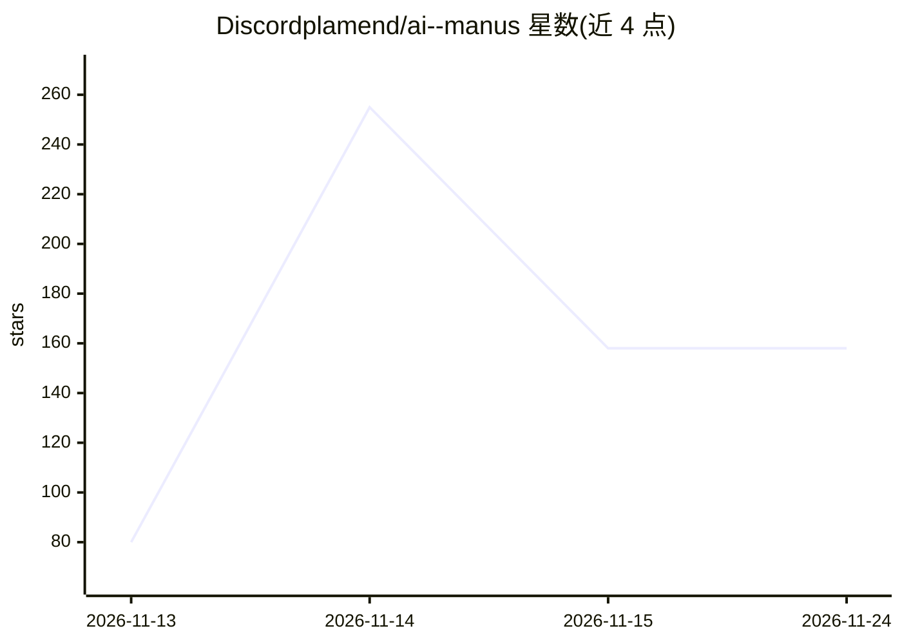

# Discordplamend/ai--manus

⭐ 158 · Apache-2.0 · 推送 2026-11-15 · [GitHub](https://github.com/Discordplamend/ai--manus) · 个人维护

**面向个人用户的自主 AI Agent：自动执行代码与浏览器操作**

自称 Manus 的自主 AI Agent，宣称能代替用户执行代码、控制浏览器（导航网页、填表、采集信息）并完成多步骤任务，面向学习、家庭与轻量办公场景的非开发用户。README 说明了启动步骤（配置、测试、调整触发方式）与硬件兼容表（最低 4GB 内存、双核 CPU）。限制：全文为功能描述性文案，未提供任何安装命令、代码入口、模型接入方式或 API 配置说明，无法从 README 验证实际实现与获取途径。

## 筛选速览

| 维度 | 判定 | 备注 |
|---|---|---|
| AI 角色 | `ai-native` | 本体是模型或模型工具 |
| 许可风险 | `permissive` | Apache-2.0 |
| 部署形态 | `None` |  |
| 模型依赖 | — | README 未给出锁定关系 |
| 硬件要求 | — | 无带数字的原话,不猜 |
| 安装摩擦 | `low` | 无编译、无系统依赖或容器化 |
| 成熟度 | — | 结构信号不足 |

## 能力要点

- 宣称支持自主代码执行与浏览器控制（导航、填表、采集信息）
- 面向非开发用户，覆盖学习、家庭与轻量办公场景
- 提供硬件兼容性表（最低双核 CPU / 4GB 内存）

## 适用场景

- 让 Agent 代为执行重复的脚本与网页操作
- 研究资料收集与整理等日常小任务
- 无需编程背景的浏览器自动化操作

## 场景标签

`浏览器自动化` `编码 Agent` · 领域:效率与自动化

## 证据(README 行号)

> L10: - **Autonomous Code Execution:** Manus AI agent runs code on its own to complete tasks, so you can focus on decisio
> L18: Manus is an autonomous AI agent designed to run code and control a browser on your behalf. Instead of acting like a

## 星数曲线

2026-11-13 80 → 2026-11-24 158（+78）

---
*卡片 v1 · prompt 1.4 · 生成 2026-11-17 · 置信度 mid · 依据 README sha `0f78ee3a5dd2` · [字段定义](../../DATASET.md)*
