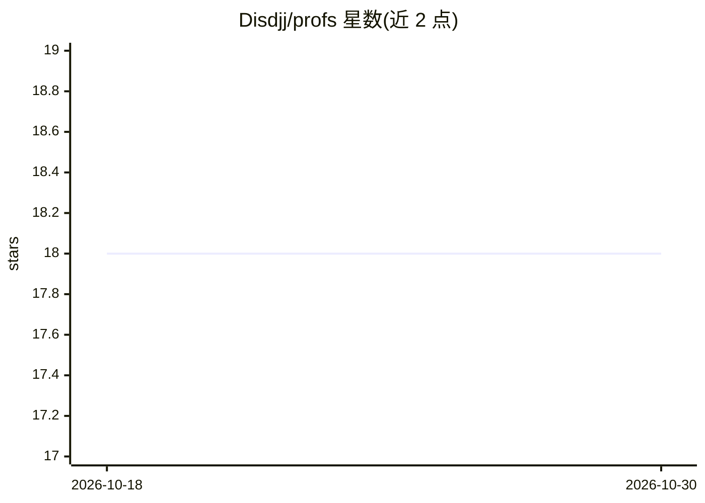

# Disdjj/profs

⭐ 18 · TypeScript · Apache-2.0 · 推送 2025-11-08 · [GitHub](https://github.com/Disdjj/profs) · 个人维护 · 中文 README

**多 AI 专家讨论平台：自动组队讨论并生成白皮书**

基于 Next.js 15 + TypeScript 构建的 Web 应用：用户输入话题后，系统通过 LLM 自动生成 5 位不同领域的 AI 专家（各有角色定位、系统提示词与模型配置），支持流式输出观看讨论、AI 主持人判断讨论是否继续、右键专家头像修改模型 ID 与温度参数，并可一键将讨论总结为结构化 Markdown 白皮书。AI 集成采用 Vercel AI SDK + OpenAI，需配置 OPENAI_API_KEY 环境变量；数据存 SQLite（Drizzle ORM）。以源码方式提供，需 Node.js 18+ 与 pnpm 8+。

## 筛选速览

| 维度 | 判定 | 备注 |
|---|---|---|
| AI 角色 | `ai-native` | 本体是模型或模型工具 |
| 许可风险 | `permissive` | Apache-2.0 |
| 部署形态 | `None` |  |
| 模型依赖 | — | README 未给出锁定关系 |
| 硬件要求 | — | 无带数字的原话,不猜 |
| 安装摩擦 | `low` | 无编译、无系统依赖或容器化 |
| 成熟度 | — | 结构信号不足 |

## 能力要点

- 根据话题自动生成 5 位不同领域 AI 专家（含系统提示词与模型配置）
- 流式讨论输出与 AI 主持人判断讨论是否继续
- 一键生成结构化 Markdown 白皮书并实时预览
- 基于 Next.js 15 + tRPC v11 + Vercel AI SDK + OpenAI

## 适用场景

- 输入一个话题，观看多位 AI 专家从不同角度展开讨论
- 将长篇讨论沉淀为结构化白皮书文档
- 为不同专家指定不同模型与温度参数进行对比讨论

## 场景标签

`多智能体` `AI 写作` · 领域:Agent 开发

## 证据(README 行号)

> L3: 一个基于 AI 的多专家协作讨论平台，能够自动生成专家团队、进行深度讨论，并生成专业白皮书。
> L7: - **🤖 智能专家生成**：根据话题自动创建 5 位不同领域的 AI 专家
> L11: - **📄 白皮书生成**：一键将讨论内容总结为结构化 Markdown 文档
> L18: - **AI 集成**: Vercel AI SDK + OpenAI

## 星数曲线

2026-10-18 18 → 2026-10-30 18（+0）

---
*卡片 v1 · prompt 1.4 · 生成 2026-10-29 · 置信度 high · 依据 README sha `d4d0a2a7a792` · [字段定义](../../DATASET.md)*
