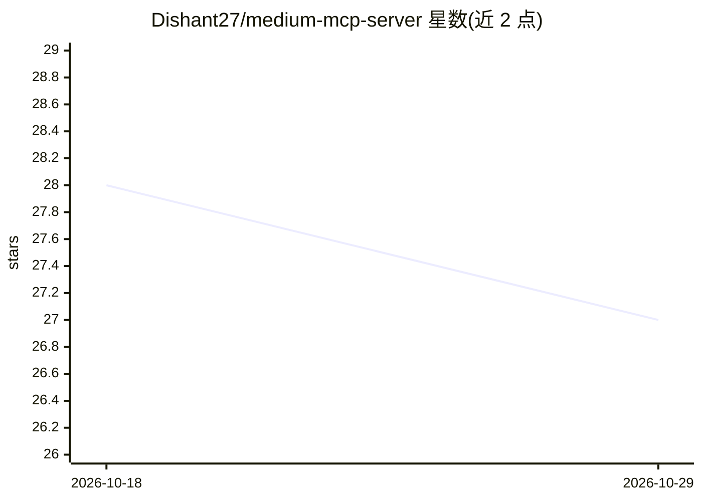

# Dishant27/medium-mcp-server

⭐ 27 · TypeScript · MIT · 推送 2026-10-16 · [GitHub](https://github.com/Dishant27/medium-mcp-server) · 个人维护

**让 AI 助手读写 Medium 账号的 MCP 服务器**

基于 TypeScript 的 Model Context Protocol 服务器，供 Claude Desktop、Cursor 等 MCP 客户端调用，工具与 Medium v1 API 端点一一对应：读取用户资料与所属出版物、以 Markdown 或 HTML 创建文章（默认草稿，可选公开或 unlisted、可发到出版物内）。不支持搜索、读文章、统计或编辑删除帖子，因官方 API 无此端点。需 Node.js 18+ 与已有的 Medium integration token；README 明确警告 Medium 官方 API 已弃用、不再发放新 token，仅持旧 token 者可用。

## 筛选速览

| 维度 | 判定 | 备注 |
|---|---|---|
| AI 角色 | `ai-ecosystem` | LLM/agent 周边工具 |
| 许可风险 | `permissive` | MIT |
| 部署形态 | `library` | 以包/库形式分发 |
| 模型依赖 | — | README 未给出锁定关系 |
| 硬件要求 | — | 无带数字的原话,不猜 |
| 安装摩擦 | `low` | 无编译、无系统依赖或容器化 |
| 成熟度 | — | 结构信号不足 |

## 能力要点

- 三个工具 1:1 映射 Medium v1 API 端点（get-profile / get-publications / publish-article）
- 文章默认创建为草稿，可选 public / unlisted 并可发布到出版物
- 支持 Claude Desktop 等任意 MCP 客户端接入

## 适用场景

- 用对话让 AI 助手把 Markdown 稿件创建为 Medium 草稿
- 查看自己的 Medium 资料与所属出版物列表
- 将稿件发布到指定的 Medium 出版物

## 场景标签

`AI 写作` · 领域:内容生成

## 证据(README 行号)

> L3: A small Model Context Protocol server that lets an MCP client (Claude Desktop, Cursor, etc.) create Medium drafts an
> L13: The tools map 1:1 to the endpoints Medium's v1 API actually has:

## 星数曲线

2026-10-18 28 → 2026-10-29 27（-1）

---
*卡片 v1 · prompt 1.4 · 生成 2026-10-26 · 置信度 high · 依据 README sha `f914ba1f26bf` · [字段定义](../../DATASET.md)*
