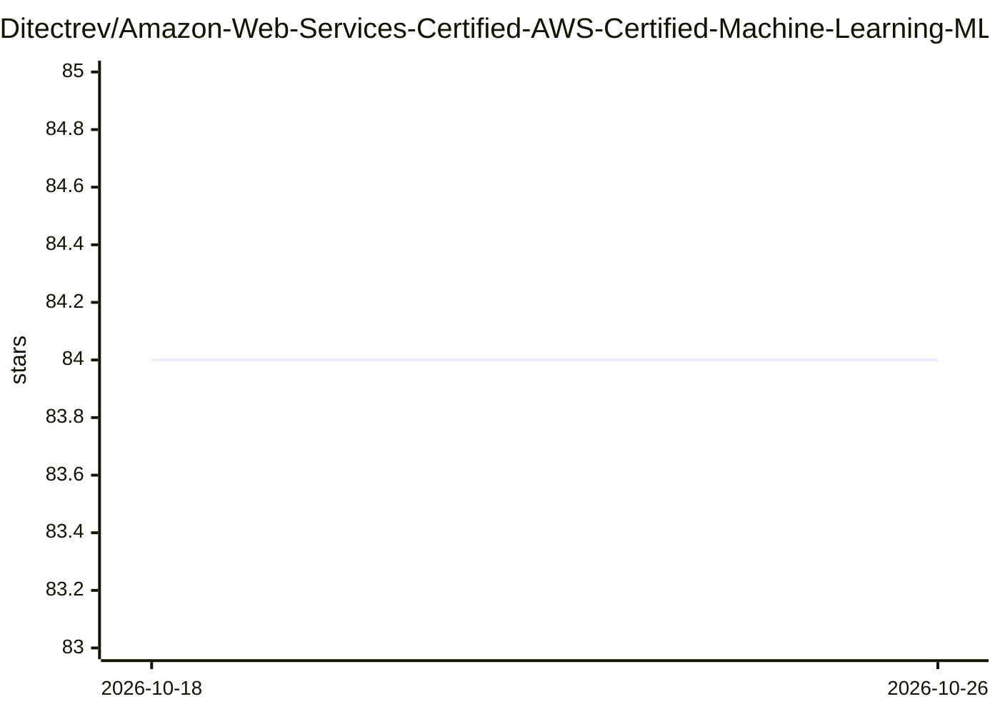

# Ditectrev/Amazon-Web-Services-Certified-AWS-Certified-Machine-Learning-MLS-C01-Practice-Tests-Exams-Question

⭐ 84 · 推送 2026-03-20 · [GitHub](https://github.com/Ditectrev/Amazon-Web-Services-Certified-AWS-Certified-Machine-Learning-MLS-C01-Practice-Tests-Exams-Question) · [官网](https://education.ditectrev.com) · 组织维护

**AWS 机器学习认证 MLS-C01 模拟题库（137 题）**

面向 AWS Certified Machine Learning Specialty (MLS-C01) 考试备考的问答式模拟测试集，含 137 道去重题目，模拟真实考试的内容、时长与通过线。题目覆盖 Amazon Athena、SageMaker、Textract、Transcribe、Kinesis、Apache Spark、CNN/RNN、K-means、PCA 等考点。仓库本身以 README 形式提供说明与题目线索，完整带答案版本（EPUB/PDF）通过 shop.ditectrev.com、Google Play Books、Etsy、eBay、Patreon 及 Udemy（含 AI 生成解析）付费获取。自 2023 年 10 月发布后持续修订错题。

## 筛选速览

| 维度 | 判定 | 备注 |
|---|---|---|
| AI 角色 | `ai-knowledge` | 知识聚合/清单类 |
| 许可风险 | `none` | — |
| 部署形态 | `None` |  |
| 模型依赖 | — | README 未给出锁定关系 |
| 硬件要求 | — | 无带数字的原话,不猜 |
| 安装摩擦 | `low` | 无编译、无系统依赖或容器化 |
| 成熟度 | — | 结构信号不足 |

## 能力要点

- 137 道去重模拟题，模拟真实考试内容、时长与通过线
- 考点覆盖 SageMaker、Textract、Transcribe、Spark、CNN/RNN 等
- 持续版本化修订（v1.0.0 至 v1.1.1）
- 声明非 Exam Dump，Udemy 付费版含 AI 生成解析

## 适用场景

- 备考 AWS MLS-C01 认证考试
- AWS/AI/数据类工程师检验考点掌握程度
- 通过付费 EPUB/PDF 版本获得带答案的完整材料

## 场景标签

`教程课程` · 领域:学习与行业

## 证据(README 行号)

> L1: # ⬆️ Amazon Web Services Certified (AWS Certified) Machine Learning Specialty (MLS-C01) Practice Tests Exams Questio
> L43: 3. Learn about topics, such as:
> L70: 7. 137 **unique** questions.

## 星数曲线

2026-10-18 84 → 2026-10-26 84（+0）

---
*卡片 v1 · prompt 1.4 · 生成 2026-10-24 · 置信度 high · 依据 README sha `54f6f2d9e7c3` · [字段定义](../../DATASET.md)*
