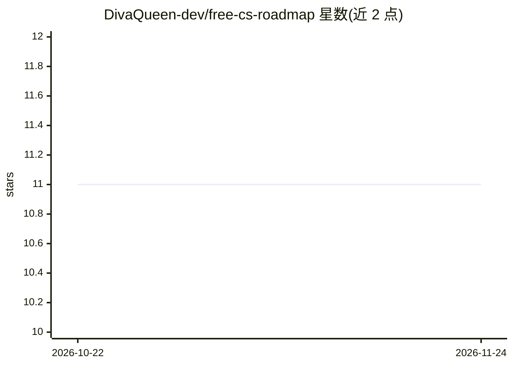

# DivaQueen-dev/free-cs-roadmap

⭐ 11 · MIT · 推送 2026-10-03 · [GitHub](https://github.com/DivaQueen-dev/free-cs-roadmap) · 个人维护

**面向转行/求职者的免费计算机科学学习路线与资源合集**

以 hub 仓库形式组织的技术入行路线指南：按读者水平（零基础/有基础/求职/非科班）分路径引导，链接到 free-dsa-roadmap、free-system-design-roadmap、free-ai-ml-llm-roadmap 等专题仓库；正文含 CS 领域介绍、行业现状、领域选择、建议学习顺序与按领域分级的免费资源清单（课程/文档/项目，标注学习时长与星级）。主打全部免费、无联盟链接，配套 Discord 社区。

## 筛选速览

| 维度 | 判定 | 备注 |
|---|---|---|
| AI 角色 | `ai-knowledge` | 知识聚合/清单类 |
| 许可风险 | `permissive` | MIT |
| 部署形态 | `None` |  |
| 模型依赖 | — | README 未给出锁定关系 |
| 硬件要求 | — | 无带数字的原话,不猜 |
| 安装摩擦 | `medium` | 含编译或系统依赖之一 |
| 成熟度 | — | 结构信号不足 |

## 能力要点

- 按四种读者水平给出不同学习路径的引导结构
- 分设 DSA、系统设计、AI/ML/LLM 等专题子仓库
- 资源按领域和难度分级，标注学习时长
- 声明全部资源免费、无付费推荐

## 适用场景

- 零基础想入行软件开发，找免费学习路线
- 准备 FAANG 或印度头部公司面试与 placement
- 非计算机专业（ECE/EEE/机械）想转行软件

## 场景标签

`精选清单` · 领域:学习与行业

## 证据(README 行号)

> L22: This repo is the **hub**. It gives you the full picture and points you to the right place. For the deep dives, each
> L217: |--------|----------|----|

## 星数曲线

2026-10-22 11 → 2026-11-24 11（+0）

---
*卡片 v1 · prompt 1.4 · 生成 2026-11-19 · 置信度 high · 依据 README sha `4e76b12abe44` · [字段定义](../../DATASET.md)*
