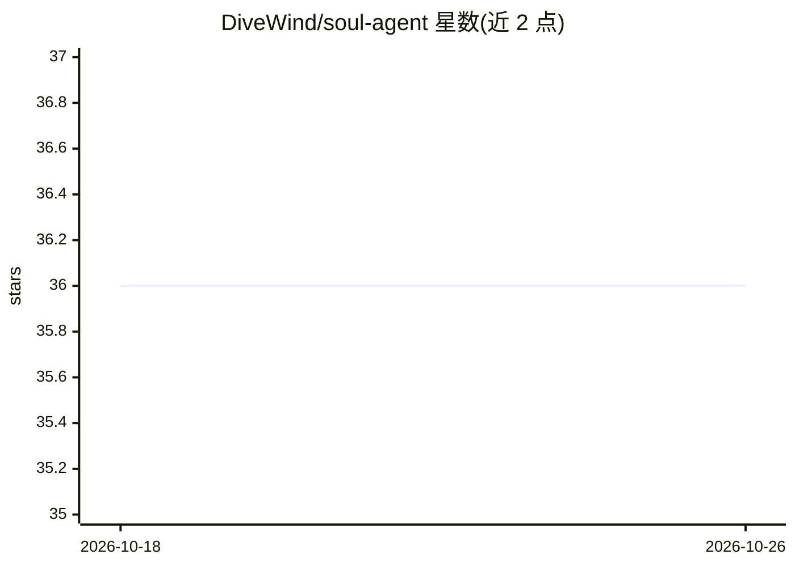

# DiveWind/soul-agent

⭐ 36 · Python · 推送 2026-04-28 · [GitHub](https://github.com/DiveWind/soul-agent) · 个人维护 · 中文 README

**为 OpenClaw agent 提供人格、心跳日常与关系记忆的技能包**

OpenClaw 技能包，让宿主 agent 具备持续运行状态：双层心跳引擎（L1 轻量检测无 LLM 消耗、L2 完整心跳每 10 分钟生成生活日志）、参考 Stanford Generative Agents 的晨间 LLM 每日计划生成、平滑过渡的情绪系统（7 天历史）、5 阶段关系进化与分层记忆目录。提供 4 种生活模板（可自定义）。叙事生成需 Anthropic API Key，无 Key 时自动降级为上下文感知模板。安装方式为复制到 OpenClaw 工作区 skills 目录并配置 cron 定时任务，用户无需运行命令。

## 筛选速览

| 维度 | 判定 | 备注 |
|---|---|---|
| AI 角色 | `ai-ecosystem` | LLM/agent 周边工具 |
| 许可风险 | `none` | — |
| 部署形态 | `None` |  |
| 模型依赖 | locked-api |  |
| 硬件要求 | — | 无带数字的原话,不猜 |
| 安装摩擦 | `low` | 无编译、无系统依赖或容器化 |
| 成熟度 | — | 结构信号不足 |

## 能力要点

- 双层心跳引擎（L1 无 LLM 检测 + L2 完整心跳），每 10 分钟更新状态
- 晨间 LLM 生成每日计划，全天叙事保持连贯
- 5 阶段关系进化，达到朋友后可主动发起联系
- 无 API Key 时自动降级到模板，基本功能不受影响

## 适用场景

- 让我的 agent 在后台持续生成日常生活与情绪状态
- 为数字陪伴 agent 建立跨次对话的话题记忆与关系阶段
- 通过对话引导完成初始化，无需手动执行命令

## 场景标签

`Agent 记忆` · 领域:Agent 开发

## 证据(README 行号)

> L7: `soul-agent` 是一个 OpenClaw 技能包，让数字 AI 拥有真实心跳——每 10 分钟更新状态，有自己的日常生活、情绪变化和与你成长的关系。
> L27: `soul-agent` v2 的核心是 **生成式架构**，参考 Stanford Generative Agents (Smallville) 的设计：
> L104: 将技能包放入 OpenClaw 工作区的 `skills/soul-agent/` 目录。

## 星数曲线

2026-10-18 36 → 2026-10-26 36（+0）

---
*卡片 v1 · prompt 1.4 · 生成 2026-10-25 · 置信度 high · 依据 README sha `6e7f5957031f` · [字段定义](../../DATASET.md)*
