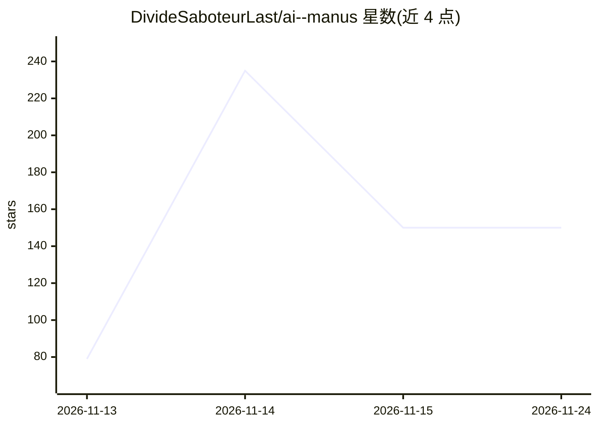

# DivideSaboteurLast/ai--manus

⭐ 150 · Apache-2.0 · 推送 2026-11-15 · [GitHub](https://github.com/DivideSaboteurLast/ai--manus) · 个人维护

**面向个人用户的自主 AI Agent，可执行代码与控制浏览器**

Manus 是一个自主运行的 AI Agent 系统，按 README 描述可代用户编写并执行脚本、打开网页、填写表单、与页面元素交互，并可跨代码与浏览器完成多步骤任务。定位为面向家庭、学习与轻量办公场景的个人助手，而非企业平台。README 提供硬件兼容表（最低 4GB 内存、双核 CPU）与启动步骤说明，但未给出具体的安装命令、下载链接或源码构建方式，功能实现细节缺乏可验证信息。

## 筛选速览

| 维度 | 判定 | 备注 |
|---|---|---|
| AI 角色 | `ai-native` | 本体是模型或模型工具 |
| 许可风险 | `permissive` | Apache-2.0 |
| 部署形态 | `None` |  |
| 模型依赖 | — | README 未给出锁定关系 |
| 硬件要求 | — | 无带数字的原话,不猜 |
| 安装摩擦 | `low` | 无编译、无系统依赖或容器化 |
| 成熟度 | — | 结构信号不足 |

## 能力要点

- 自主代码执行：代理自行编写并运行脚本完成任务
- 浏览器控制：导航网站、填写表单、收集信息
- 代码与浏览器操作可在同一任务流中衔接
- 面向家庭、学习与轻量任务的个人助手定位

## 适用场景

- 让学生整理研究笔记、运行小型计算脚本
- 让代理跨多个网页收集数据并准备摘要
- 把重复性的小型任务委托给后台代理处理

## 场景标签

`AI 助手` `编码 Agent` `浏览器自动化` · 领域:效率与自动化

## 证据(README 行号)

> L10: - **Autonomous Code Execution:** Manus AI agent runs code on its own to complete tasks, so you can focus on decisio
> L11: - **Browser Control Made Simple:** Manus browser control lets the agent navigate websites, fill forms, and gather i
> L18: Manus is an autonomous AI agent designed to run code and control a browser on your behalf. Instead of acting like a

## 星数曲线

2026-11-13 79 → 2026-11-24 150（+71）

---
*卡片 v1 · prompt 1.4 · 生成 2026-11-17 · 置信度 low · 依据 README sha `0f78ee3a5dd2` · [字段定义](../../DATASET.md)*
