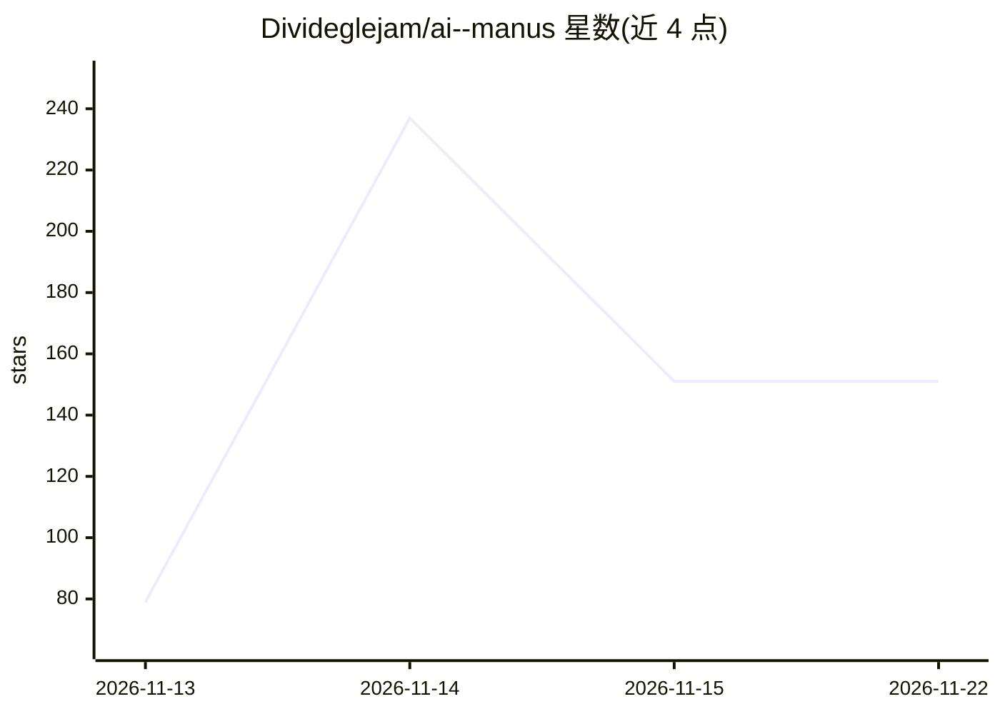

# Divideglejam/ai--manus

⭐ 151 · Apache-2.0 · 推送 2026-11-15 · [GitHub](https://github.com/Divideglejam/ai--manus) · 个人维护

**面向个人用户的自主 AI Agent，执行代码与浏览器操作**

自称 Manus 的自主 AI Agent 系统，README 声称可在沙箱中运行工具：自主编写并执行脚本、控制浏览器（导航网页、填表、采集信息）、执行多步骤日常任务，定位为家庭、学习与轻量办公场景的个人助手。给出系统兼容性表（最低双核 CPU、4GB 内存）。但 README 为营销式描述，未提供任何安装命令、源码结构说明或运行机制细节，无法验证实际实现。

## 筛选速览

| 维度 | 判定 | 备注 |
|---|---|---|
| AI 角色 | `ai-native` | 本体是模型或模型工具 |
| 许可风险 | `permissive` | Apache-2.0 |
| 部署形态 | `None` |  |
| 模型依赖 | — | README 未给出锁定关系 |
| 硬件要求 | — | 无带数字的原话,不猜 |
| 安装摩擦 | `low` | 无编译、无系统依赖或容器化 |
| 成熟度 | — | 结构信号不足 |

## 能力要点

- 声明支持自主代码执行与浏览器控制
- 声明支持脚本与浏览器操作衔接的多步骤任务
- 给出最低 4GB 内存/双核 CPU 的兼容性表

## 适用场景

- 让 Agent 代替人工执行网页填表与信息采集
- 运行小脚本与快速计算整理研究笔记
- 后台处理重复性日常小任务

## 场景标签

`AI 助手` `浏览器自动化` `编码 Agent` · 领域:效率与自动化

## 证据(README 行号)

> L10: - **Autonomous Code Execution:** Manus AI agent runs code on its own to complete tasks, so you can focus on decisio
> L18: Manus is an autonomous AI agent designed to run code and control a browser on your behalf. Instead of acting like a

## 星数曲线

2026-11-13 79 → 2026-11-22 151（+72）

---
*卡片 v1 · prompt 1.4 · 生成 2026-11-17 · 置信度 low · 依据 README sha `0f78ee3a5dd2` · [字段定义](../../DATASET.md)*
