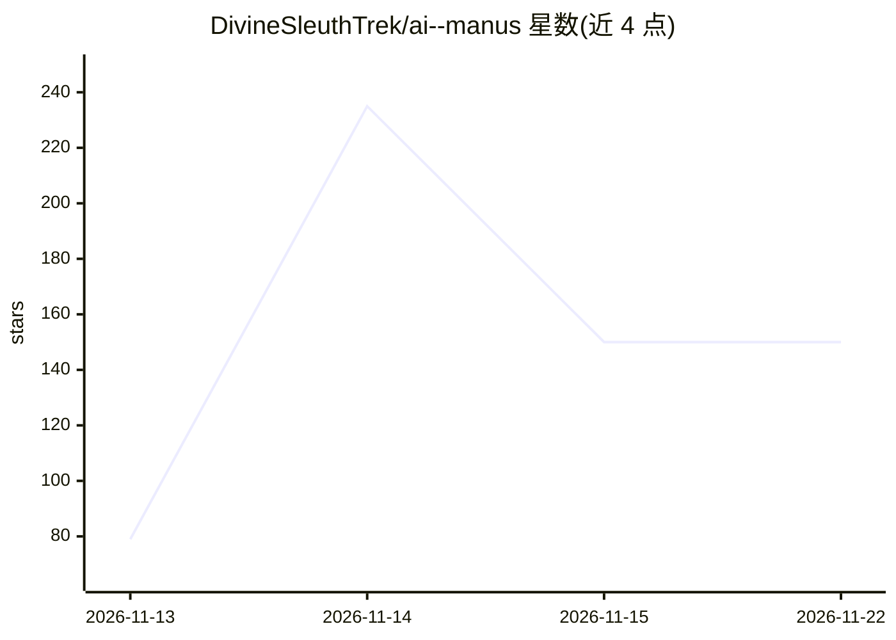

# DivineSleuthTrek/ai--manus

⭐ 150 · Apache-2.0 · 推送 2026-11-15 · [GitHub](https://github.com/DivineSleuthTrek/ai--manus) · 个人维护

**面向个人用户的自主 AI Agent：代跑代码并操控浏览器**

README 描述一个名为 Manus 的自主 AI agent，可在用户授权下编写并执行脚本、操控浏览器完成表单填写、信息收集等多步任务，定位为家庭、学习与轻量办公场景的个人助手，明确声明非企业级平台。给出最低双核 CPU/4GB 内存等兼容性表格与六步上手流程，但全文未提供任何安装命令、下载链接、技术架构、模型接入方式或代码仓库内容。主题标签涉及 openai/anthropic/gemini 等，README 正文未提及。

## 筛选速览

| 维度 | 判定 | 备注 |
|---|---|---|
| AI 角色 | `ai-native` | 本体是模型或模型工具 |
| 许可风险 | `permissive` | Apache-2.0 |
| 部署形态 | `None` |  |
| 模型依赖 | — | README 未给出锁定关系 |
| 硬件要求 | — | 无带数字的原话,不猜 |
| 安装摩擦 | `low` | 无编译、无系统依赖或容器化 |
| 成熟度 | — | 结构信号不足 |

## 能力要点

- 自主执行代码与浏览器操控，支持多步任务
- 脚本与浏览器动作可在同一流程中衔接
- 声明面向家庭、学习与轻量办公的小规模场景

## 适用场景

- 让 agent 代跑小脚本和自动化浏览器操作
- 收集网页资料并整理为小结
- 后台处理重复性的日常小任务

## 场景标签

`AI 助手` `浏览器自动化` `编码 Agent` · 领域:效率与自动化

## 证据(README 行号)

> L10: - **Autonomous Code Execution:** Manus AI agent runs code on its own to complete tasks, so you can focus on decisio
> L18: Manus is an autonomous AI agent designed to run code and control a browser on your behalf. Instead of acting like a

## 星数曲线

2026-11-13 79 → 2026-11-22 150（+71）

---
*卡片 v1 · prompt 1.4 · 生成 2026-11-17 · 置信度 low · 依据 README sha `a3d88e202bf0` · [字段定义](../../DATASET.md)*
