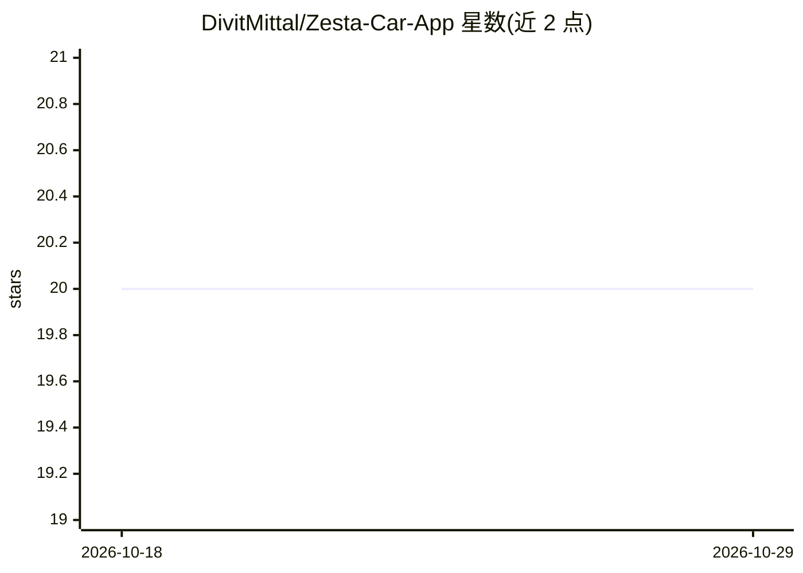

# DivitMittal/Zesta-Car-App

⭐ 20 · Jupyter Notebook · MIT · 推送 2026-10-22 · [GitHub](https://github.com/DivitMittal/Zesta-Car-App) · [官网](https://deepwiki.com/DivitMittal/Zesta-Car-App) · 个人维护

**跨平台车牌识别应用：拍照即得车辆相关信息**

Zesta 是一个跨平台（iOS/Android/Web）移动应用：用手机摄像头拍摄车牌，图像以 base64 经 Node.js 服务器转发给 Python 脚本，由 Ultralytics YOLO 检测车牌、EasyOCR 识别文字、OpenCV 处理图像，再返回车牌号与相关车辆信息。客户端基于 Expo（React Native），通过 WebSocket 与服务器双向通信。项目自述为 MVP，计划接入印度 Parivahan 数据库、罚单追踪、保险/PUC 状态等功能。README 未给出安装命令。

## 筛选速览

| 维度 | 判定 | 备注 |
|---|---|---|
| AI 角色 | `ai-native` | 本体是模型或模型工具 |
| 许可风险 | `permissive` | MIT |
| 部署形态 | `None` |  |
| 模型依赖 | — | README 未给出锁定关系 |
| 硬件要求 | — | 无带数字的原话,不猜 |
| 安装摩擦 | `low` | 无编译、无系统依赖或容器化 |
| 成熟度 | `idea` | |

## 能力要点

- 摄像头拍照→YOLO 检测→EasyOCR 识别的车牌识别流水线
- iOS/Android/Web 跨平台（Expo/React Native）
- WebSocket 实时双向通信

## 适用场景

- 扫车牌快速获取车辆相关信息
- 未来用作一站式车辆管理应用（罚单、保险、PUC 查询）

## 场景标签

`OCR` · 领域:感知与多模态

## 证据(README 行号)

> L21: The backend is powered by a Node.js server that communicates with a Python script. The Python script uses a deep le
> L64: // Python -> EasyOCR [label=" Recognize Text "];

## 星数曲线

2026-10-18 20 → 2026-10-29 20（+0）

---
*卡片 v1 · prompt 1.4 · 生成 2026-10-28 · 置信度 high · 依据 README sha `1351d5428879` · [字段定义](../../DATASET.md)*
