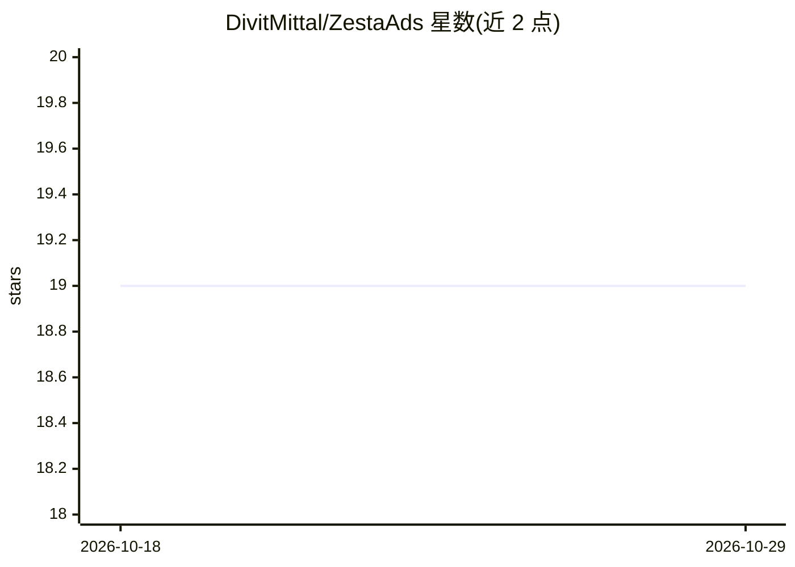

# DivitMittal/ZestaAds

⭐ 19 · HTML · 推送 2026-10-22 · [GitHub](https://github.com/DivitMittal/ZestaAds) · [官网](https://deepwiki.com/DivitMittal/ZestaAds) · 个人维护

**概念阶段的生成式 AI 广告网络：个性化、UI 融合的广告 API**

README 描述一个面向广告主、发布者与消费者的广告网络平台设想：使用生成式 AI 与微调 LLM 生成文本和图片两种格式的个性化广告，强调广告与页面 UI 融合；架构上包含竞价系统与开发者 API，由发布者通过 API 接入；提供 CPM/CPC/CPA 指标。仓库带 Nix flake 检查徽章，但 README 未给出安装或运行步骤，属概念/原型阶段文档。

## 筛选速览

| 维度 | 判定 | 备注 |
|---|---|---|
| AI 角色 | `ai-native` | 本体是模型或模型工具 |
| 许可风险 | `none` | — |
| 部署形态 | `None` |  |
| 模型依赖 | — | README 未给出锁定关系 |
| 硬件要求 | — | 无带数字的原话,不猜 |
| 安装摩擦 | `low` | 无编译、无系统依赖或容器化 |
| 成熟度 | — | 结构信号不足 |

## 能力要点

- 生成式 AI 生成文本与图片广告
- 微调 LLM 实现个性化广告内容
- 包含竞价系统与开发者 API 的架构设计
- 提供 CPM/CPC/CPA 广告活动指标

## 适用场景

- 发布者通过开发者 API 接入广告变现
- 广告主投放个性化生成式广告
- 按 CPM/CPC/CPA 跟踪广告效果

## 场景标签

 · 领域:广告/营销技术

## 证据(README 行号)

> L20: * **Generative AI:** We use generative AI to create ads that are more engaging and interactive than traditional ad 
> L21: * **Personalization:** Our platform uses fine-tuned Large Language Models (LLMs) to deliver personalized ad content

## 星数曲线

2026-10-18 19 → 2026-10-29 19（+0）

---
*卡片 v1 · prompt 1.4 · 生成 2026-10-29 · 置信度 mid · 依据 README sha `59ef916c8c27` · [字段定义](../../DATASET.md)*
