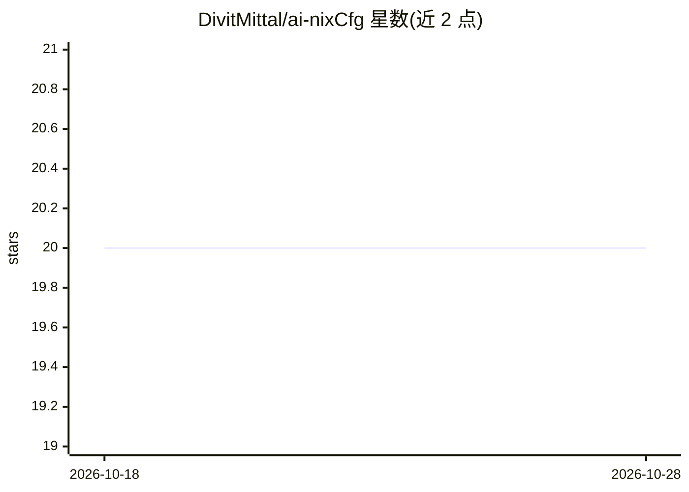

# DivitMittal/ai-nixCfg

⭐ 20 · Nix · MIT · 推送 2026-10-25 · [GitHub](https://github.com/DivitMittal/ai-nixCfg) · [官网](https://deepwiki.com/DivitMittal/ai-nixCfg) · 个人维护

**AI 编码助手与 LLM 工具的 Nix home-manager 模块集**

提供可复用 Nix home-manager 模块与个人配置，声明式管理一整套 AI 开发工具链：agentic 编码助手（Claude Code、Codex、OpenCode 等）、LLM CLI、MCP 集成、Talon 语音输入、终端多路复用器、token 压缩代理及自定义包。机制上通过 flake 四棵树自动导入，`_common` 纯数据库将共享 commands/skills/agents/rules 渲染为各工具原生格式，一次编辑多工具生效。支持 Linux 与 macOS，部分工具仅限 aarch64-darwin；面向已使用 Nix 的开发者。

## 筛选速览

| 维度 | 判定 | 备注 |
|---|---|---|
| AI 角色 | `ai-ecosystem` | LLM/agent 周边工具 |
| 许可风险 | `permissive` | MIT |
| 部署形态 | `desktop` | 安装包/桌面程序 |
| 模型依赖 | — | README 未给出锁定关系 |
| 硬件要求 | — | 无带数字的原话,不猜 |
| 安装摩擦 | `low` | 无编译、无系统依赖或容器化 |
| 成熟度 | — | 结构信号不足 |

## 能力要点

- 覆盖 9 类 AI 工具目录（编码助手/LLM CLI/编排/语音/MCP 服务器等）
- `_common` 纯数据共享库一次编辑传播到所有工具
- `nix run github:DivitMittal/ai-nixCfg#ai` 可临时进入完整 AI 工具链 shell，不写入 home 目录
- 模块含 permissions/hooks/MCP 覆盖等细粒度配置（如 Claude Code 拦截 rm -rf 与 .env 访问）

## 适用场景

- 用 Nix 声明式、可复现地安装和管理多个 AI 编码助手
- 把共享 commands/skills/rules 统一分发到 Claude Code/Codex/Copilot 等工具
- 临时进入一个带全套 AI CLI 的环境而不污染现有配置

## 场景标签

 · 领域:开发环境配置/AI 工具链

## 证据(README 行号)

> L15: This repository provides reusable Nix home-manager modules and personal configurations for a complete AI developmen
> L21: |**Agentic coding assistants**|Claude Code, Codex, GitHub Copilot CLI, OpenCode, Crush, Antigravity CLI, Pi, Hermes

## 星数曲线

2026-10-18 20 → 2026-10-28 20（+0）

---
*卡片 v1 · prompt 1.4 · 生成 2026-10-28 · 置信度 high · 依据 README sha `ab39c7f241a2` · [字段定义](../../DATASET.md)*
