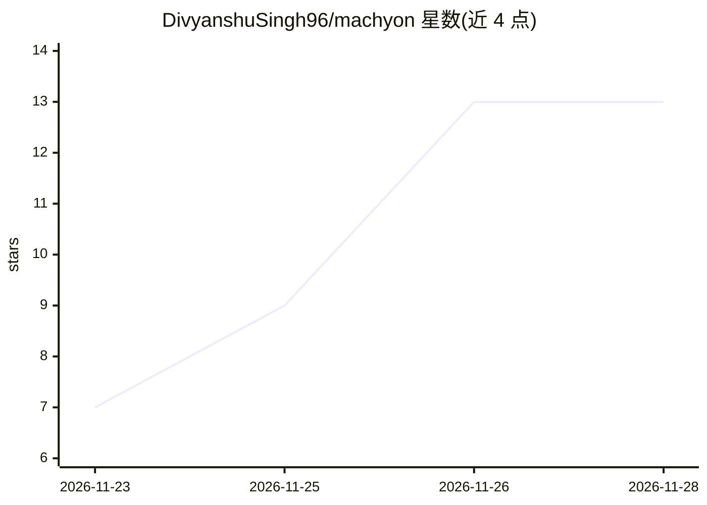

# DivyanshuSingh96/machyon

⭐ 13 · Python · MIT · 推送 2026-11-25 · [GitHub](https://github.com/DivyanshuSingh96/machyon) · [官网](https://divyanshusingh96.github.io/machyon/) · 个人维护

**给 ML 从业者的可靠异步图片批量下载 Python 库**

基于 asyncio/aiohttp 的图片批量下载库与 CLI：输入 CSV/TSV/JSON/Parquet/DataFrame/URL 列表，输出报告记录每个文件是已下载、已存在还是失败及原因。自适应并发、尊重 Retry-After 的退避重试、magic bytes 校验剔除 HTML 错误页、原子写文件、重跑即断点续传（支持 HTTP Range）。提供 CLI、同步/异步 API、类 API 与浏览器本地 UI（仅监听 127.0.0.1）。Python 3.11+，源自作者参加 Amazon ML Challenge 的经历。

## 筛选速览

| 维度 | 判定 | 备注 |
|---|---|---|
| AI 角色 | `ai-enhanced` | 去掉 AI 部分产品仍成立 |
| 许可风险 | `permissive` | MIT |
| 部署形态 | `library` | 以包/库形式分发 |
| 模型依赖 | — | README 未给出锁定关系 |
| 硬件要求 | — | 无带数字的原话,不猜 |
| 安装摩擦 | `low` | 无编译、无系统依赖或容器化 |
| 成熟度 | `idea` | |

## 能力要点

- 每行均有结局：下载、跳过或写入 failed_downloads.jsonl 的失败原因
- 自适应并发与逐主机记忆最优设置， honour Retry-After
- magic bytes 校验拒绝 HTML 错误页存为 .jpg
- 断点续传：重跑时已存在文件在秒级跳过（README 称 10 万行 0.5s）

## 适用场景

- 下载 Amazon ML Challenge 这类大赛的商品图片数据集
- 为计算机视觉训练集批量拉取带 URL 清单的图片
- 下载海量图片后排查哪些行失败并补拉
- 在 Jupyter/FastAPI 等异步环境中内嵌批量下载

## 场景标签

 · 领域:数据工程/下载工具

## 证据(README 行号)

> L10: Machyon (MAK-ee-on: Mach + tach yon ) is a new kind of image downloader.
> L85: **🧩 A library first.** Use it from sync or async code, with any input (CSV, TSV, TXT, JSON, JSONL, Parquet, DataFra

## 星数曲线

2026-11-23 7 → 2026-11-28 13（+6）

---
*卡片 v1 · prompt 1.4 · 生成 2026-11-23 · 置信度 high · 依据 README sha `da4e456a0f3c` · [字段定义](../../DATASET.md)*
