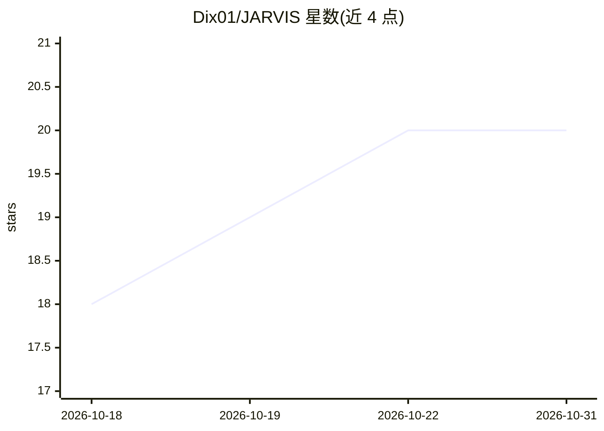

# Dix01/JARVIS

⭐ 20 · Python · MIT · 推送 2026-10-01 · [GitHub](https://github.com/Dix01/JARVIS) · 个人维护

**Windows 本地优先语音 AI 助手：语音/视觉/图像与3D生成/80+工具**

面向 Windows 桌面用户的本地优先 AI 助手：以语音唤醒词驱动，通过 faster-whisper 做语音识别、Piper/Edge TTS 做语音输出，支持摄像头视觉分析、FLUX 本地图像生成、TRELLIS/Hunyuan3D 图生 3D、SQLite 跨会话语义记忆，以及约 80 个工具（文件、shell、浏览器、系统监控等）控制本机。LLM 接入任何 OpenAI 兼容端点或 Anthropic Messages API（Ollama/LM Studio/vLLM 等）。界面为 React + Three.js 全息 HUD，Electron 桌面应用，FastAPI 后端。限制：Windows 10/11、Python 3.10+、Node 18+，图像/3D/Whisper 需 NVIDIA GPU（无 GPU 时这些功能降级）。

## 筛选速览

| 维度 | 判定 | 备注 |
|---|---|---|
| AI 角色 | `ai-native` | 本体是模型或模型工具 |
| 许可风险 | `permissive` | MIT |
| 部署形态 | `None` |  |
| 模型依赖 | local-ok | 支持本地模型 |
| 硬件要求 | — | 无带数字的原话,不猜 |
| 安装摩擦 | `low` | 无编译、无系统依赖或容器化 |
| 成熟度 | — | 结构信号不足 |

## 能力要点

- 完整语音闭环：唤醒词、faster-whisper STT、Piper/Riva/Edge TTS 三级语音输出
- 本地 FLUX.2-klein-4B 图像生成与 TRELLIS.2/Hunyuan3D 图生 3D（GLB）
- SQLite 本地语义记忆，3D 点云可视化（Neural Galaxy）
- 约 80 个工具分 12 组插件，SAFE/CAUTION/DANGEROUS 三级安全分级与操作日志

## 适用场景

- 用语音指挥 AI 操作本机文件、shell 与浏览器
- 在本机 GPU 上生成图像并把图像转成 3D 模型
- 跨会话记忆个人偏好、笔记与常用命令并随时召回
- 无需云端账号，全程本地运行语音对话助手

## 场景标签

`语音 Agent` `AI 助手` `图像生成` · 领域:对话与助手

## 证据(README 行号)

> L36: J.A.R.V.I.S. is a **desktop AI command center** for Windows. Point it at any
> L68: |🎙️ **Full voice loop**|Wake-word ("Hey JARVIS"), server-side Whisper STT, British-butler TTS, barge-in cancel, tim

## 星数曲线

2026-10-18 18 → 2026-10-31 20（+2）

---
*卡片 v1 · prompt 1.4 · 生成 2026-10-28 · 置信度 high · 依据 README sha `ca3416d0eaa3` · [字段定义](../../DATASET.md)*
