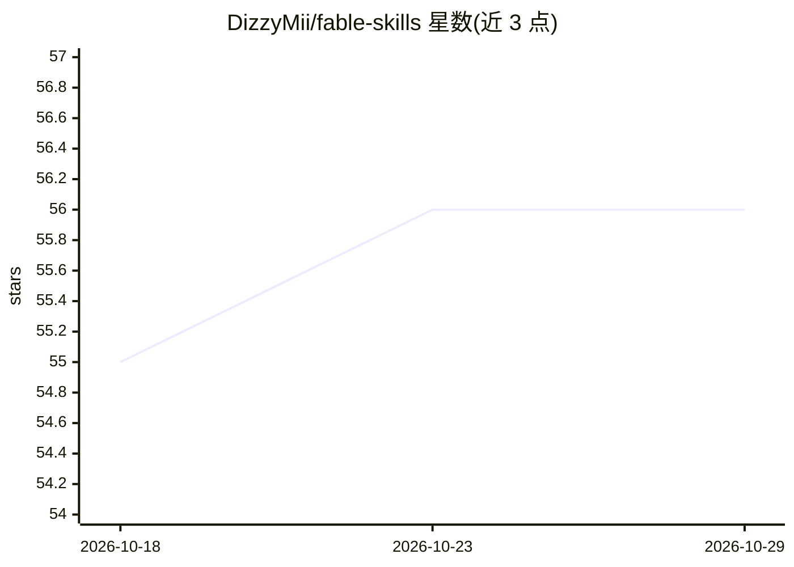

# DizzyMii/fable-skills

⭐ 56 · TypeScript · MIT · 推送 2026-10-06 · [GitHub](https://github.com/DizzyMii/fable-skills) · [官网](https://github.com/DizzyMii/fable-skills) · 个人维护

**约束 Claude Code 行为纪律的 6 个技能包，供 Opus 4.8 使用**

由 Fable 5 模型生成的 6 个纯 Markdown Claude Code 技能（fable-outcome-first、fable-finish-your-turn 等），分别约束回答结构、收尾、声明校准、改动范围、代码风格与上下文开销。每个技能带“合理化借口—反驳”表，针对测试中逐字捕获的模型辩解。安装为运行脚本将技能文件夹复制进 ~/.claude/skills/，可选写入 CLAUDE.md 激活块。仓库附压力测试记录与 bench 自动化评测脚手架（npm 运行，含 mock 模式）。测试针对 Opus 4.8，作者自述日常生产力提升未验证。

## 筛选速览

| 维度 | 判定 | 备注 |
|---|---|---|
| AI 角色 | `ai-ecosystem` | LLM/agent 周边工具 |
| 许可风险 | `permissive` | MIT |
| 部署形态 | `library` | 以包/库形式分发 |
| 模型依赖 | — | README 未给出锁定关系 |
| 硬件要求 | — | 无带数字的原话,不猜 |
| 安装摩擦 | `low` | 无编译、无系统依赖或容器化 |
| 成熟度 | `idea` | |

## 能力要点

- 6 个技能各覆盖一项行为纪律（回答/收尾/声明/范围/代码/上下文）
- 每技能附合理化借口对照表，借口来自测试中逐字捕获
- 附 RED/GREEN 压力测试记录与可自动化评测脚手架（mock 模式零 API 花费）
- 安装脚本幂等，macOS/Linux 与 Windows PowerShell 各有脚本

## 适用场景

- 让 Claude Code 的回答先给结论、减少冗余说明
- 限制改动范围，避免把顺手的重构混进本该一行的修复
- 约束模型只在已验证的层级上做声明（写了/能跑/已验证）

## 场景标签

`提示工程` · 领域:Agent 开发

## 证据(README 行号)

> L33: The skills are plain Markdown. Installing means copying six folders into `~/.claude/skills/` and (optionally) addin
> L131: **Which models?** Written and tested for Opus 4.8 in Claude Code. They're plain skills, so they load anywhere Clau

## 星数曲线

2026-10-18 55 → 2026-10-29 56（+1）

---
*卡片 v1 · prompt 1.4 · 生成 2026-10-24 · 置信度 mid · 依据 README sha `15fee6c20edb` · [字段定义](../../DATASET.md)*
