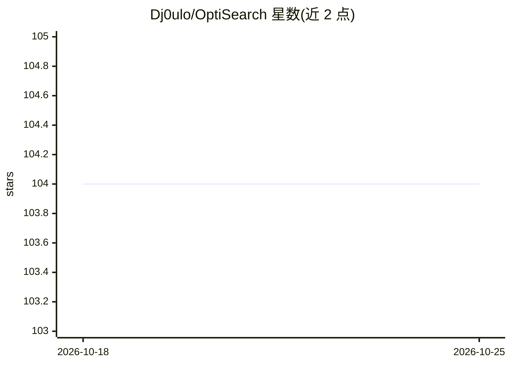

# Dj0ulo/OptiSearch

⭐ 104 · JavaScript · GPL-3.0 · 推送 2026-04-12 · [GitHub](https://github.com/Dj0ulo/OptiSearch) · [官网](http://www.optisearch.io/) · 个人维护

**在搜索结果旁展示 AI 回答与结果信息的浏览器扩展**

三个共享同一代码核心的浏览器扩展：OptiSearch 在搜索结果旁展示来自结果页的相关信息；AI answer in Google 展示 Microsoft Copilot 的回答；Gemini next to Google results 展示 Google Gemini 的回答。支持 Google、Bing、Baidu、DuckDuckGo、Ecosia、Brave Search 六个搜索引擎。通过 Chrome Web Store 与 Mozilla Add-on Store 安装，也可从源码用 npm 安装依赖后以 node build.mjs 构建各扩展的 manifest 与打包产物。

## 筛选速览

| 维度 | 判定 | 备注 |
|---|---|---|
| AI 角色 | `ai-enhanced` | 去掉 AI 部分产品仍成立 |
| 许可风险 | `viral` | GPL-3.0 |
| 部署形态 | `library` | 以包/库形式分发 |
| 模型依赖 | — | README 未给出锁定关系 |
| 硬件要求 | — | 无带数字的原话,不猜 |
| 安装摩擦 | `low` | 无编译、无系统依赖或容器化 |
| 成熟度 | — | 结构信号不足 |

## 能力要点

- 三个扩展共享同一代码核心（OptiSearch / Copilot 回答 / Gemini 回答）
- 支持 Google、Bing、Baidu、DuckDuckGo、Ecosia、Brave Search 六个搜索引擎
- 提供 Chrome 与 Firefox 商店安装及源码构建流程（build.mjs 支持指定扩展、目标浏览器与打包）

## 适用场景

- 在 Google 等搜索引擎中直接查看 AI 回答，无需跳转
- 在搜索结果旁获取结果页的相关信息摘要
- 自行为 Chrome 或 Firefox 构建并安装这些扩展

## 场景标签

`AI 助手` · 领域:对话与助手

## 证据(README 行号)

> L5: This repository contains the code of **OptiSearch**, **AI answer in Google** and **Gemini next to Google results** b
> L19: Displays the answer from Microsoft Copilot alongside search engine results.
> L28: Displays the answer from Google Gemini alongside search engine results.

## 星数曲线

2026-10-18 104 → 2026-10-25 104（+0）

---
*卡片 v1 · prompt 1.4 · 生成 2026-10-23 · 置信度 high · 依据 README sha `4adf38f979b2` · [字段定义](../../DATASET.md)*
