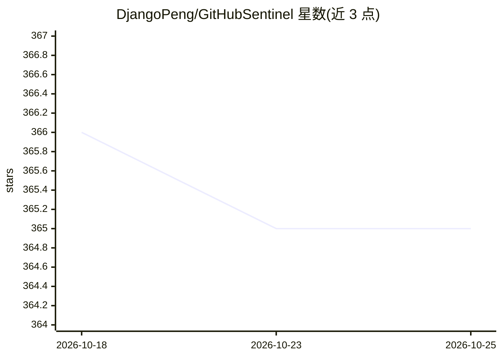

# DjangoPeng/GitHubSentinel

⭐ 365 · Jupyter Notebook · Apache-2.0 · 推送 2026-02-25 · [GitHub](https://github.com/DjangoPeng/GitHubSentinel) · 个人维护 · 中文 README

**AI Agent：自动追踪 GitHub 开源项目动态并生成报告**

面向开源爱好者、个人开发者和投资人的信息检索 AI Agent：订阅管理 GitHub 仓库，自动检索提交、Issue、PR 等动态，结合 OpenAI API 或 Ollama 私有化模型生成项目进展报告，并可扩展到 Hacker News 热门话题挖掘；支持邮件通知、守护进程定时任务与 Gradio Web 界面三种运行方式。提供 Docker 构建脚本（含构建期单元测试校验），需 Python 3.12+ 与 GitHub Token 配置。

## 筛选速览

| 维度 | 判定 | 备注 |
|---|---|---|
| AI 角色 | `ai-native` | 本体是模型或模型工具 |
| 许可风险 | `permissive` | Apache-2.0 |
| 部署形态 | `self-host` | docker 或自建部署 |
| 模型依赖 | local-ok | 支持本地模型 |
| 硬件要求 | — | 无带数字的原话,不猜 |
| 安装摩擦 | `low` | 无编译、无系统依赖或容器化 |
| 成熟度 | — | 结构信号不足 |

## 能力要点

- 订阅仓库自动检索提交/Issue/PR 更新并汇总
- OpenAI API 与 Ollama 私有化模型双通道生成报告
- 命令行、守护进程、Gradio Web 界面三种运行方式
- Docker 构建流程内置单元测试校验

## 适用场景

- 自动跟踪关注的 GitHub 开源项目进展并收到邮件通知
- 用本地 Ollama 模型生成项目进展报告
- 挖掘 Hacker News 热门技术话题

## 场景标签

`AI 写作` · 领域:内容生成

## 证据(README 行号)

> L21: - **多模型支持**：结合 OpenAI 和 Ollama 模型，生成自然语言项目报告，提供更智能、精准的信息服务。
> L27: GitHub Sentinel 不仅能帮助用户自动跟踪和分析 `GitHub 开源项目` 的最新动态，还能快速扩展到其他信息渠道，如 `Hacker News` 的热门话题，提供更全面的信息挖掘与分析能力。

## 星数曲线

2026-10-18 366 → 2026-10-25 365（-1）

---
*卡片 v1 · prompt 1.4 · 生成 2026-10-21 · 置信度 high · 依据 README sha `f433c32610e6` · [字段定义](../../DATASET.md)*
