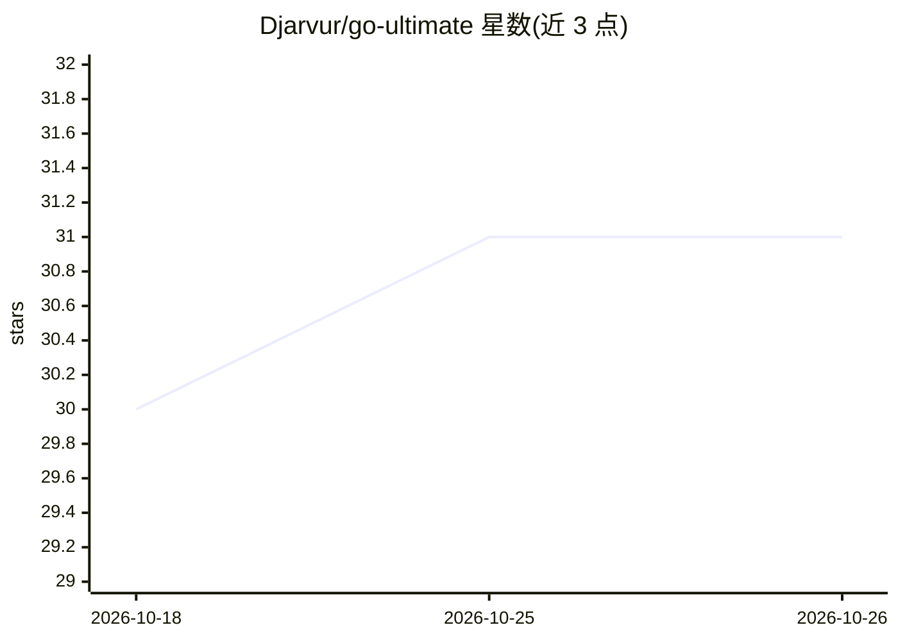

# Djarvur/go-ultimate

⭐ 31 · Go · MIT · 推送 2026-10-25 · [GitHub](https://github.com/Djarvur/go-ultimate) · [官网](https://github.com/Djarvur/cc-mplace) · 个人维护

**面向多家 agent 宿主的 Go 编程技能包：路由 Go 任务到架构与规范**

单一 AI agent 技能（SKILL.md 格式），综合 13 个上游来源（四个通用 Go 技能、Google/Uber 风格指南、仓库实践、agent/MCP 文档），按项目类型（CLI、库、后端服务、MCP server、AI agent）经决策树路由到对应参考文档与审查清单，并按 Go 版本门控特性。支持 Claude Code、Codex、Cursor、Copilot CLI、OpenCode 等宿主安装，含项目脚手架模板、来源漂移检测脚本与 MIT 许可。

## 筛选速览

| 维度 | 判定 | 备注 |
|---|---|---|
| AI 角色 | `ai-ecosystem` | LLM/agent 周边工具 |
| 许可风险 | `permissive` | MIT |
| 部署形态 | `None` |  |
| 模型依赖 | — | README 未给出锁定关系 |
| 硬件要求 | — | 无带数字的原话,不猜 |
| 安装摩擦 | `low` | 无编译、无系统依赖或容器化 |
| 成熟度 | — | 结构信号不足 |

## 能力要点

- 按项目类型决策树路由到架构、规范与审查清单
- 13 个上游来源综合，带来源版本 pin 与漂移检测脚本
- 提供 6 类可构建、过 vet 与 -race 测试的脚手架模板
- 通过插件市场原生安装于 Claude Code/Codex/Cursor/Copilot CLI 等宿主

## 适用场景

- 让 Claude Code/Codex 等 AI 编程代理遵循固定的 Go 架构与工程规范
- 在 agent 中按 Go 版本自动门控语言特性使用
- 检测技能上游来源是否发生变更漂移

## 场景标签

`代码审查` `代码生成` · 领域:编码与开发

## 证据(README 行号)

> L3: A single, opinionated AI agent skill for writing the best Go programs — synthesized from four general-Go skills, fou
> L5: > **Status:** v0.12.0. Designed for Claude Code, Codex, Cursor, Grok Build, GitHub Copilot CLI, OpenCode, and any ha
> L21: go-ultimate ships a plugin manifest per harness (see the repo root), so the same skill installs natively on each. I

## 星数曲线

2026-10-18 30 → 2026-10-26 31（+1）

---
*卡片 v1 · prompt 1.4 · 生成 2026-10-26 · 置信度 high · 依据 README sha `b0491fa518cc` · [字段定义](../../DATASET.md)*
