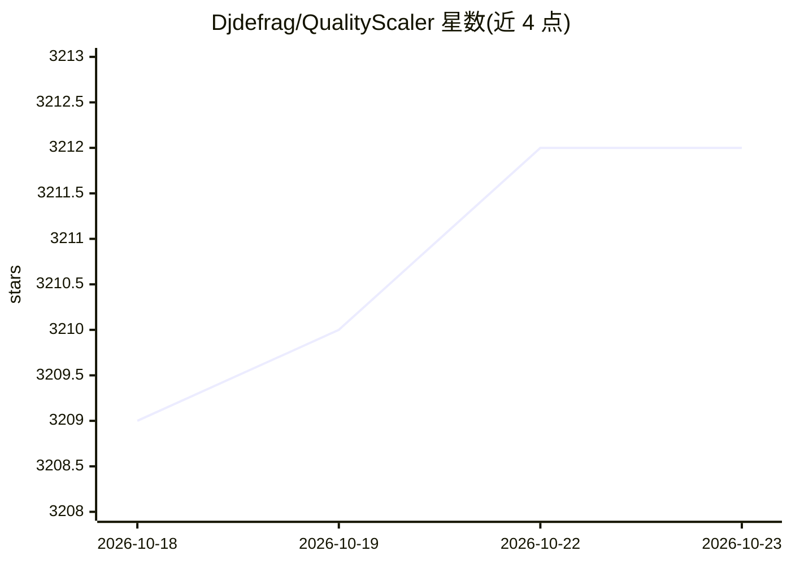

# Djdefrag/QualityScaler

⭐ 3,212 · Python · MIT · 推送 2026-08-27 · [GitHub](https://github.com/Djdefrag/QualityScaler) · 个人维护

**Windows 图像/视频 AI 超分与降噪桌面应用**

面向普通用户的 Windows 桌面应用，基于 ONNX Runtime DirectML 对照片和视频进行 AI 放大、增强与降噪，内置 BSRGAN / Real-ESRGAN / IRCNN / SRVGGNetCompact 等模型，支持任意 DirectX12 兼容 GPU（AMD/Intel/NVIDIA）。提供图像自动分块以规避显存限制、视频暂停/恢复、多 GPU、硬件加速编码（nvenc/amf/qsv）等功能；全程离线运行无需联网。通过 itch.io 与 Steam 分发，也可从源码自行构建。

## 筛选速览

| 维度 | 判定 | 备注 |
|---|---|---|
| AI 角色 | `ai-native` | 本体是模型或模型工具 |
| 许可风险 | `permissive` | MIT |
| 部署形态 | `desktop` | 安装包/桌面程序 |
| 模型依赖 | — | README 未给出锁定关系 |
| 硬件要求 | `gpu-8g` | |
| 安装摩擦 | `medium` | 含编译或系统依赖之一 |
| 成熟度 | — | 结构信号不足 |

## 能力要点

- 图像/视频 AI 放大、增强与降噪，多格式输入输出
- 任意 DirectX12 GPU 支持（AMD/Intel/NVIDIA）与多 GPU
- 自动图像分块规避显存限制，视频支持 STOP & RESUME
- 离线运行，无需网络连接

## 适用场景

- 放大老照片或低分辨率图片并去除噪点
- 提升视频分辨率，可暂停续跑批量处理
- 在 AMD/Intel/NVIDIA 显卡上本地离线处理素材

## 场景标签

`图像视频处理` · 领域:感知与多模态

## 证据(README 行号)

> L28: QualityScaler is a Windows app powered by AI to enhance, upscale and de-noise photographs and videos.
> L115:  - [x] New AI engine powered by onnxruntime-directml (https://github.com/microsoft/onnxruntime))

## 星数曲线

2026-10-18 3,209 → 2026-10-23 3,212（+3）

---
*卡片 v1 · prompt 1.4 · 生成 2026-10-20 · 置信度 high · 依据 README sha `f35b0fb0557c` · [字段定义](../../DATASET.md)*
