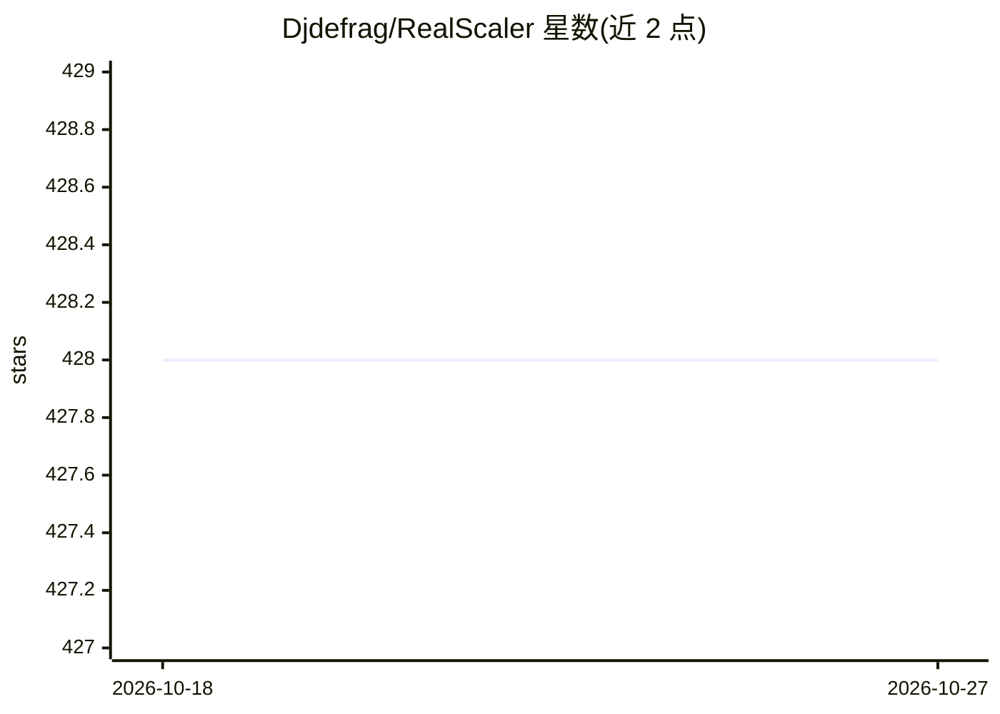

# Djdefrag/RealScaler

⭐ 428 · Python · MIT · 推送 2026-04-26 · [GitHub](https://github.com/Djdefrag/RealScaler) · 个人维护

**Windows 图像/视频 AI 超分应用（Real-ESRGAN）**

基于 Real-ESRGAN 模型的 Windows 桌面应用，对图像与视频执行超分、增强与降噪，支持 jpg/png/heic 等图像格式和 mp4/mkv/gif 等视频格式。推理引擎为 onnxruntime-directml，可运行于任意 Directx12 兼容 GPU（AMD/Intel/Nvidia，需 ≥4GB VRAM），支持多 GPU、自动图像分块规避显存限制、视频断点续传与硬件加速编码，全程离线运行无需联网。提供 itch.io 下载入口，也可用 Python 源码自行构建（需自行下载 AI 模型与 FFMPEG）。

## 筛选速览

| 维度 | 判定 | 备注 |
|---|---|---|
| AI 角色 | `ai-native` | 本体是模型或模型工具 |
| 许可风险 | `permissive` | MIT |
| 部署形态 | `desktop` | 安装包/桌面程序 |
| 模型依赖 | — | README 未给出锁定关系 |
| 硬件要求 | `gpu-8g` | |
| 安装摩擦 | `medium` | 含编译或系统依赖之一 |
| 成熟度 | — | 结构信号不足 |

## 能力要点

- Real-ESRGAN 模型的图像/视频超分与降噪
- onnxruntime-directml 推理，兼容 AMD/Intel/Nvidia 的 Directx12 GPU
- 自动图像分块规避显存限制，支持多 GPU 与视频断点续传
- 离线运行，无需互联网连接

## 适用场景

- 把老照片或低分辨率图片超分为高分辨率
- 给动画或视频做 4 倍超分并保留音轨
- 在没有独立 N 卡的机器上用 A 卡/核显跑超分

## 场景标签

`图像视频处理` · 领域:感知与多模态

## 证据(README 行号)

> L12: RealScaler is a Windows app powered by RealESRGAN AI to enhance, upscale and de-noise photos and videos.
> L86:  - [x] New AI engine powered by onnxruntime-directml (https://github.com/microsoft/onnxruntime))

## 星数曲线

2026-10-18 428 → 2026-10-27 428（+0）

---
*卡片 v1 · prompt 1.4 · 生成 2026-10-21 · 置信度 high · 依据 README sha `15fec6f18ef9` · [字段定义](../../DATASET.md)*
