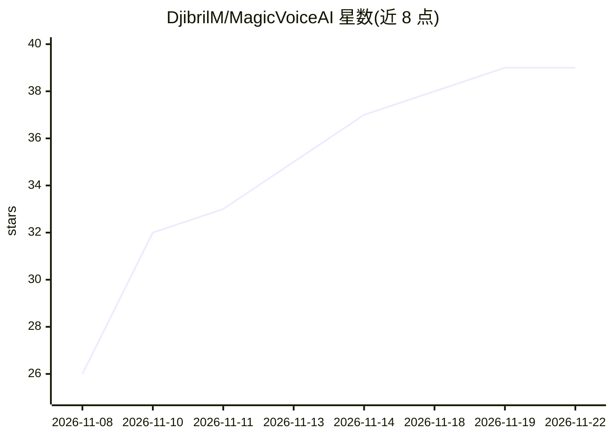

# DjibrilM/MagicVoiceAI

⭐ 39 · TypeScript · 推送 2026-11-17 · [GitHub](https://github.com/DjibrilM/MagicVoiceAI) · 个人维护

**离线本地多说话人 TTS 桌面工作室（CosyVoice 3）**

基于 Electron、React、TypeScript 与 @qvac/sdk 构建的离线桌面文字转语音工作室，运行 CosyVoice 3（FunAudioLLM）模型套件（共 5 个模型，含 0.5B 语音骨干、flow-matching 声码器、S3Tok 分词器、CAM++ 说话人编码器与 Lava-SR 超分模块），提供语音合成、零样本声音克隆（WAV/MP3/AAC 或麦克风）与多说话人对话脚本生成。支持 GPU（Apple Silicon Metal，默认）与 CPU 推理切换。面向 macOS Apple Silicon 与 Windows x64 用户，从源码克隆构建运行。

## 筛选速览

| 维度 | 判定 | 备注 |
|---|---|---|
| AI 角色 | `ai-native` | 本体是模型或模型工具 |
| 许可风险 | `none` | — |
| 部署形态 | `None` |  |
| 模型依赖 | — | README 未给出锁定关系 |
| 硬件要求 | — | 无带数字的原话,不猜 |
| 安装摩擦 | `low` | 无编译、无系统依赖或容器化 |
| 成熟度 | — | 结构信号不足 |

## 能力要点

- 运行 CosyVoice 3 模型套件（5 个模型，Q8_0/FP16/FP32）
- 零样本声音克隆：自定义音频文件或麦克风录音
- 多说话人对话脚本生成，含情绪标签（whisper/yell/breath 等）
- Lava-SR 将 24kHz 音频超分至 48kHz

## 适用场景

- 离线本地合成语音，不依赖云服务与网络
- 从参考音频克隆声音并做多角色对话配音
- 为多角色剧本生成带情绪与停顿的语音

## 场景标签

`语音合成` · 领域:内容生成

## 证据(README 行号)

> L11: **Magic-Voice AI** is an offline desktop Text-to-Speech (TTS) studio built with Electron, React, TypeScript, Tailwi
> L13: Magic-Voice AI runs exclusively on **CosyVoice 3** (FunAudioLLM), offering continuous flow-matching acoustic genera

## 星数曲线

2026-11-08 26 → 2026-11-22 39（+13）

---
*卡片 v1 · prompt 1.4 · 生成 2026-11-18 · 置信度 high · 依据 README sha `679172fbd8a0` · [字段定义](../../DATASET.md)*
