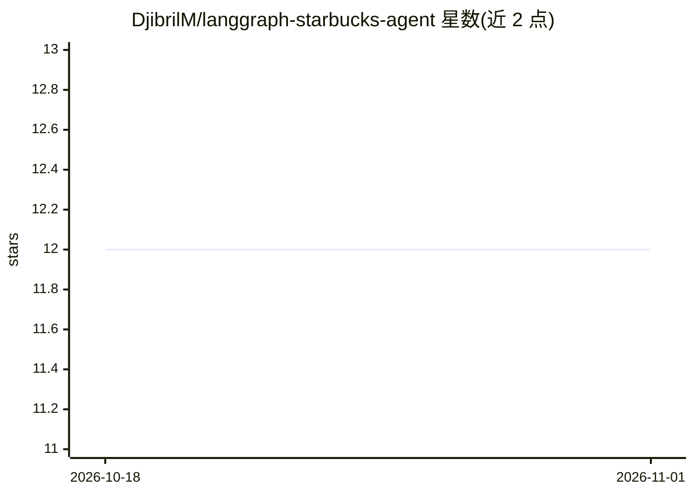

# DjibrilM/langgraph-starbucks-agent

⭐ 12 · TypeScript · NOASSERTION · 推送 2025-11-16 · [GitHub](https://github.com/DjibrilM/langgraph-starbucks-agent) · 个人维护

**用对话订购星巴克饮品的 NestJS AI Agent**

基于 NestJS 的对话式下单服务：用户以自然语言点星巴克饮品，Agent 由 LangGraph 状态机编排对话流程，接入 Google Generative AI 模型；缺少尺寸、加料等信息时追问，确认后调用 create_order 工具将订单写入 MongoDB（Zod 校验），并用 MongoDBSaver 保存和恢复会话状态。响应固定包含 message、current_order、suggestions、progress 的结构化 JSON。通过 git clone 源码安装，需配置 GOOGLE_API_KEY 与 MONGO_URI。

## 筛选速览

| 维度 | 判定 | 备注 |
|---|---|---|
| AI 角色 | `ai-native` | 本体是模型或模型工具 |
| 许可风险 | `none` | NOASSERTION |
| 部署形态 | `None` |  |
| 模型依赖 | — | README 未给出锁定关系 |
| 硬件要求 | — | 无带数字的原话,不猜 |
| 安装摩擦 | `low` | 无编译、无系统依赖或容器化 |
| 成熟度 | — | 结构信号不足 |

## 能力要点

- LangGraph 状态机管理多轮订购对话流程
- create_order 工具将订单写入 MongoDB，插入前经 Zod 校验
- MongoDBSaver 持久化会话状态，支持恢复对话
- 响应含结构化 JSON：message / current_order / suggestions / progress

## 适用场景

- 通过自然语言对话完成星巴克饮品下单
- 为点单类业务搭建可持久化会话的 AI Agent 服务
- 参考 LangGraph + NestJS + MongoDB 的 Agent 工程实现

## 场景标签

 · 领域:对话式应用/电商点单

## 证据(README 行号)

> L3: This project implements a **NestJS-based conversational AI agent** that allows users to order drinks from Starbucks.
> L4: The AI agent is powered by **LangChain's LangGraph** framework, connected to a **MongoDB** database, and enhanced wi
> L26: 1. User sends a **query** (e.g., "I want a latte with almond milk").

## 星数曲线

2026-10-18 12 → 2026-11-01 12（+0）

---
*卡片 v1 · prompt 1.4 · 生成 2026-11-01 · 置信度 high · 依据 README sha `f635444df82e` · [字段定义](../../DATASET.md)*
