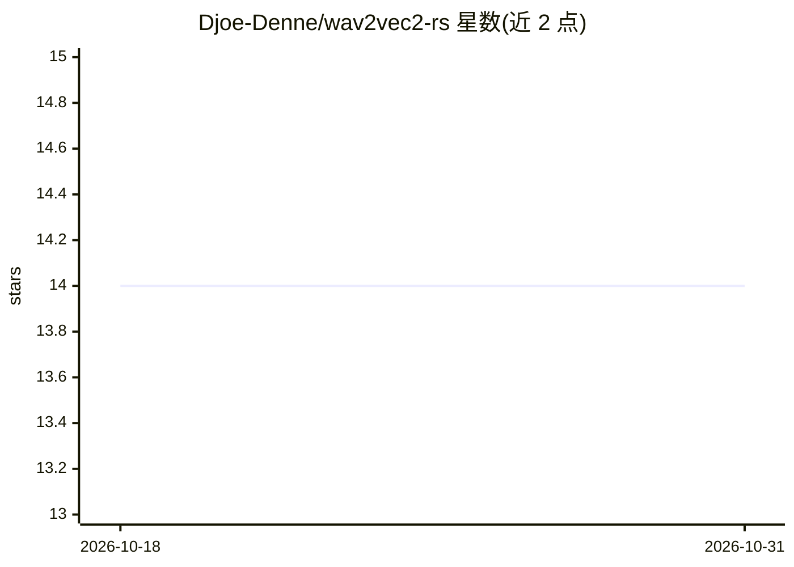

# Djoe-Denne/wav2vec2-rs

⭐ 14 · Rust · 推送 2026-04-26 · [GitHub](https://github.com/Djoe-Denne/wav2vec2-rs) · 个人维护

**Rust 实现的 CTC 强制对齐库：输出毫秒级词级时间戳**

以 Rust 编写的 CTC 强制对齐库，基于 wav2vec2 声学模型，将已知转写文本对齐到音频，输出词级毫秒时间边界与逐词置信度。流水线覆盖原始音频到带时间戳词序列，提供 CPU/wgpu/CUDA 三个 Viterbi 后端与 Candle/ONNX Runtime 两种模型运行时，附 alignment_report 评测基准 CLI（处理 LibriSpeech 测试集、对比 TextGrid、生成质量/性能报告）。需 Rust 1.75+ 编译，输入音频须为 16 kHz mono f32；GPU 特性未在 CI 测试。适用场景包括字幕生成、语音语料标注、有声书切分与发音分析。

## 筛选速览

| 维度 | 判定 | 备注 |
|---|---|---|
| AI 角色 | `ai-native` | 本体是模型或模型工具 |
| 许可风险 | `none` | — |
| 部署形态 | `library` | 以包/库形式分发 |
| 模型依赖 | — | README 未给出锁定关系 |
| 硬件要求 | — | 无带数字的原话,不猜 |
| 安装摩擦 | `high` | 编译与系统依赖俱全 |
| 成熟度 | — | 结构信号不足 |

## 能力要点

- CTC Viterbi 强制对齐，可达带剪枝将 DP 降为 O(T·S)
- 三种计算后端（CPU / wgpu / CUDA）与两种模型运行时（Candle / ONNX Runtime）
- 零拷贝 CUDA 路径：log-softmax 与 Viterbi 全程在 GPU 上执行
- alignment_report CLI 生成 JSON 质量报告与 TextGrid 输出

## 适用场景

- 为字幕生成或有声书切分获取词级时间戳
- 语音语料标注与强制对齐评测
- 对比不同运行时/后端的强制对齐性能

## 场景标签

 · 领域:语音处理/强制对齐

## 证据(README 行号)

> L5: A Rust library for **CTC forced alignment** using wav2vec2 acoustic models. Maps a known transcript onto an audio si
> L9: The library implements the full pipeline — from raw audio to timestamped words — with three parallel Viterbi backend
> L17: - **Two model runtimes**: Candle (pure Rust, safetensors) and ONNX Runtime (with CUDA EP support)

## 星数曲线

2026-10-18 14 → 2026-10-31 14（+0）

---
*卡片 v1 · prompt 1.4 · 生成 2026-10-31 · 置信度 high · 依据 README sha `22df845480f6` · [字段定义](../../DATASET.md)*
