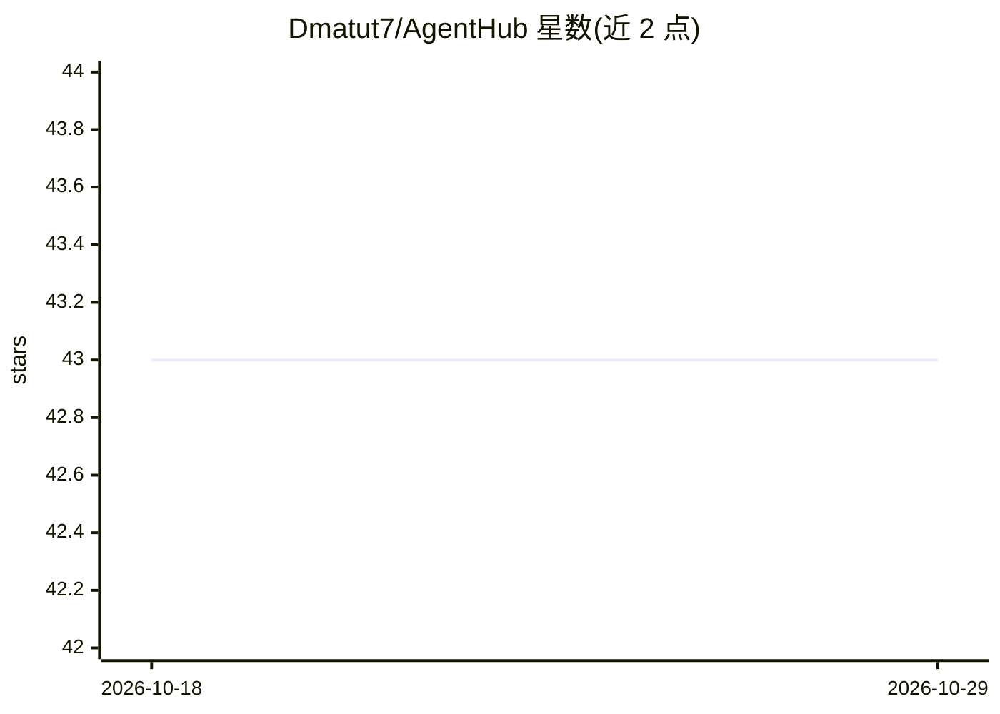

# Dmatut7/AgentHub

⭐ 43 · Python · MIT · 推送 2026-02-03 · [GitHub](https://github.com/Dmatut7/AgentHub) · [官网](https://github.com/Dmatut7/AgentHub#readme) · 个人维护

**多 AI Agent 协作编排框架：一条命令启动 5 Agent 开发团队**

开源多 Agent 编排框架，通过消息路由架构协调多个 AI CLI 工具（Codex、Claude Code 等）协同完成软件开发任务。单命令启动 1 个协调 Agent（MAIN）与 4 个执行 Agent（前端/后端/数据库/支持），提供标准化 AI 间消息协议、任务分解与调度、进度看板、文件锁、ACK 确认与自动重试、JSONL 消息持久化与崩溃恢复。需 macOS（Linux 支持在计划中）、Python 3.8+、终端与 AI CLI 工具，通过 git clone 源码与启动脚本运行。

## 筛选速览

| 维度 | 判定 | 备注 |
|---|---|---|
| AI 角色 | `ai-ecosystem` | LLM/agent 周边工具 |
| 许可风险 | `permissive` | MIT |
| 部署形态 | `None` |  |
| 模型依赖 | locked-api |  |
| 硬件要求 | — | 无带数字的原话,不猜 |
| 安装摩擦 | `low` | 无编译、无系统依赖或容器化 |
| 成熟度 | — | 结构信号不足 |

## 能力要点

- 单命令启动 1 协调 Agent + 4 执行 Agent 的开发团队
- 标准化 AI 间消息协议（review/assign/verify/done 等 8 种类型）
- ACK 双层确认、指数退避重试、幂等去duplication与崩溃恢复
- 支持自定义 Agent 数量与不同 AI CLI 工具（Codex、Claude Code 等）

## 适用场景

- 用多个 AI CLI Agent 并行开发功能模块并整合
- 搭建 MAIN 分派、多 Agent 并行评审的代码审查流程
- 多 Agent 并行调查与修复 Bug 后由 MAIN 验证

## 场景标签

`Agent 框架` `多智能体` `代码审查` · 领域:Agent 开发

## 证据(README 行号)

> L19: **AgentHub** is an open-source **Multi-Agent Orchestration Framework** that enables reliable communication and coor
> L108: - Support for different AI CLI tools (Codex, Claude Code, etc.)

## 星数曲线

2026-10-18 43 → 2026-10-29 43（+0）

---
*卡片 v1 · prompt 1.4 · 生成 2026-10-25 · 置信度 high · 依据 README sha `a94dcf1c4d25` · [字段定义](../../DATASET.md)*
