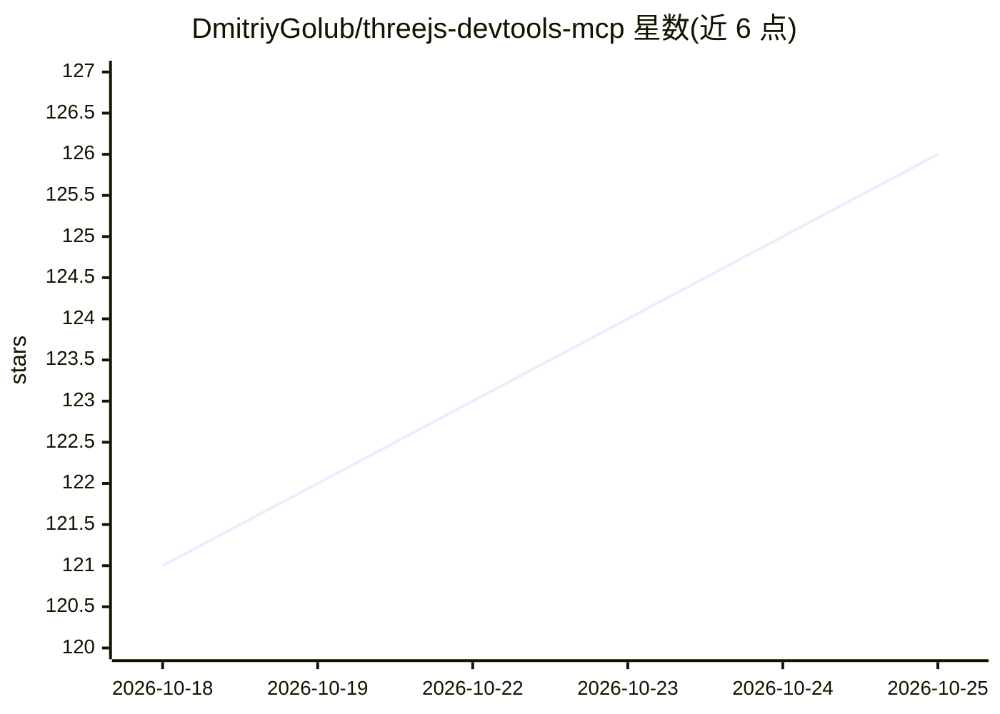

# DmitriyGolub/threejs-devtools-mcp

⭐ 128 · TypeScript · MIT · 推送 2026-10-14 · [GitHub](https://github.com/DmitriyGolub/threejs-devtools-mcp) · [官网](https://www.npmjs.com/package/threejs-devtools-mcp) · 个人维护

**Three.js 场景的 MCP 工具服务器：让 AI agent 实时检查与修改 3D 场景**

一个 MCP server，向 AI agent 提供 69 个工具，覆盖 Three.js 场景的对象、材质、着色器、纹理、灯光、动画、性能与内存检查，以及网站审计、视频帧捕获和 Playwright 辅助。改动分四类标注：只读检查、浏览器内实时预览（不落盘）、调试可视化、写入源码；实时改动可经 pending_changes 输出为可粘贴代码并可撤销。通过 WebSocket 桥接浏览器工作，支持原生 Three.js 与 React Three Fiber、WebGL 与 WebGPU 渲染器。以 npx 运行，提供 Claude Code、Cursor、Windsurf、VS Code 等客户端的配置说明。

## 筛选速览

| 维度 | 判定 | 备注 |
|---|---|---|
| AI 角色 | `ai-ecosystem` | LLM/agent 周边工具 |
| 许可风险 | `permissive` | MIT |
| 部署形态 | `library` | 以包/库形式分发 |
| 模型依赖 | — | README 未给出锁定关系 |
| 硬件要求 | — | 无带数字的原话,不猜 |
| 安装摩擦 | `medium` | 含编译或系统依赖之一 |
| 成熟度 | — | 结构信号不足 |

## 能力要点

- 69 个工具覆盖场景、材质、着色器、灯光、动画、性能与内存
- 改动分四类标注：检查/实时预览/调试可视化/写入代码，实时改动可撤销并导出为代码
- web_audit 检查模糊画布、空闲渲染、超大纹理、阴影开销与 draw call 等问题
- 支持自有浏览器、服务端启动的 Chrome 或自有 Playwright 测试三种连接方式

## 适用场景

- 用对话让 AI agent 检查场景树、调试模型不可见等问题
- 在浏览器中实时试改材质/灯光/相机，满意后再写入源码
- 对 Three.js 网站做移动端与性能审计
- 录制虚拟化时间的帧序列用于宣传视频制作

## 场景标签

 · 领域:前端/3D 图形开发工具

## 证据(README 行号)

> L8: MCP server for inspecting Three.js scenes in real time, trying changes live in the browser, and turning them into co
> L10: **Zero changes to your project.** Works with vanilla Three.js and React Three Fiber, on WebGLRenderer and WebGPURen

## 星数曲线

2026-10-18 121 → 2026-10-25 126（+5）

---
*卡片 v1 · prompt 1.4 · 生成 2026-10-23 · 置信度 high · 依据 README sha `8c3e3d51429a` · [字段定义](../../DATASET.md)*
