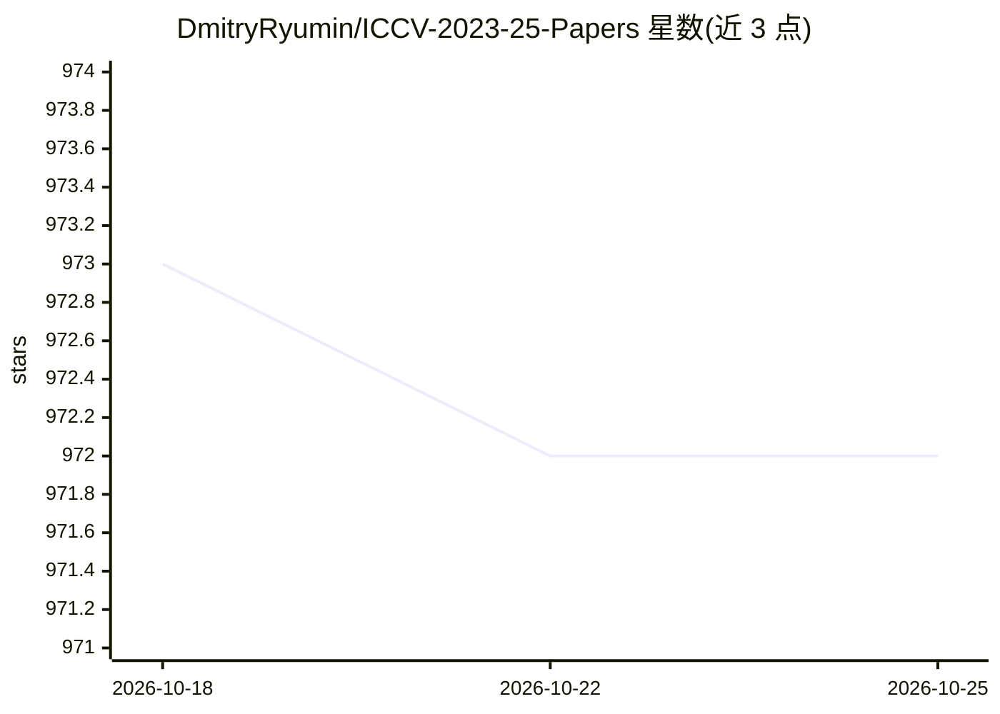

# DmitryRyumin/ICCV-2023-25-Papers

⭐ 972 · Python · MIT · 推送 2025-11-07 · [GitHub](https://github.com/DmitryRyumin/ICCV-2023-25-Papers) · [官网](https://huggingface.co/spaces/DmitryRyumin/NewEraAI-Papers) · 个人维护

**ICCV 2023-2025 计算机视觉论文清单：含代码与视频链接**

Awesome 系列的 ICCV 会议论文聚合仓库：按会议届次（2023/2025）与主题分节收录论文，每节提供 Papers、Preprints、Open Code、Videos 链接，覆盖多模态学习、3D 重建、分割、生成模型、生物特征识别等数十个方向；通过 GitHub Actions 从源仓库解析 Markdown 生成 JSON，并同步到 Hugging Face Spaces 的 NewEraAI-Papers 应用供检索浏览。面向计算机视觉与深度学习研究人员，随会议进程持续更新。

## 筛选速览

| 维度 | 判定 | 备注 |
|---|---|---|
| AI 角色 | `ai-knowledge` | 知识聚合/清单类 |
| 许可风险 | `permissive` | MIT |
| 部署形态 | `None` |  |
| 模型依赖 | — | README 未给出锁定关系 |
| 硬件要求 | — | 无带数字的原话,不猜 |
| 安装摩擦 | `low` | 无编译、无系统依赖或容器化 |
| 成熟度 | — | 结构信号不足 |

## 能力要点

- 按主题分节收录 ICCV 2023/2025 论文及代码、预印本、视频链接
- GitHub Actions 自动解析生成 JSON 并同步 Hugging Face 应用
- 附带其他 AI 会议（CVPR/ECCV/NeurIPS 等）论文集合的索引表

## 适用场景

- 查找 ICCV 各主题方向的论文及对应开源代码
- 跟踪计算机视觉与深度学习的最新研究进展
- 通过 Hugging Face 应用浏览检索论文列表

## 场景标签

`精选清单` · 领域:学习与行业

## 证据(README 行号)

> L79: ICCV 2025 Papers: Explore a comprehensive collection of cutting-edge research papers presented at *ICCV 2025*, the 
> L161:  Section

## 星数曲线

2026-10-18 973 → 2026-10-25 972（-1）

---
*卡片 v1 · prompt 1.4 · 生成 2026-10-21 · 置信度 high · 依据 README sha `c12352256282` · [字段定义](../../DATASET.md)*
