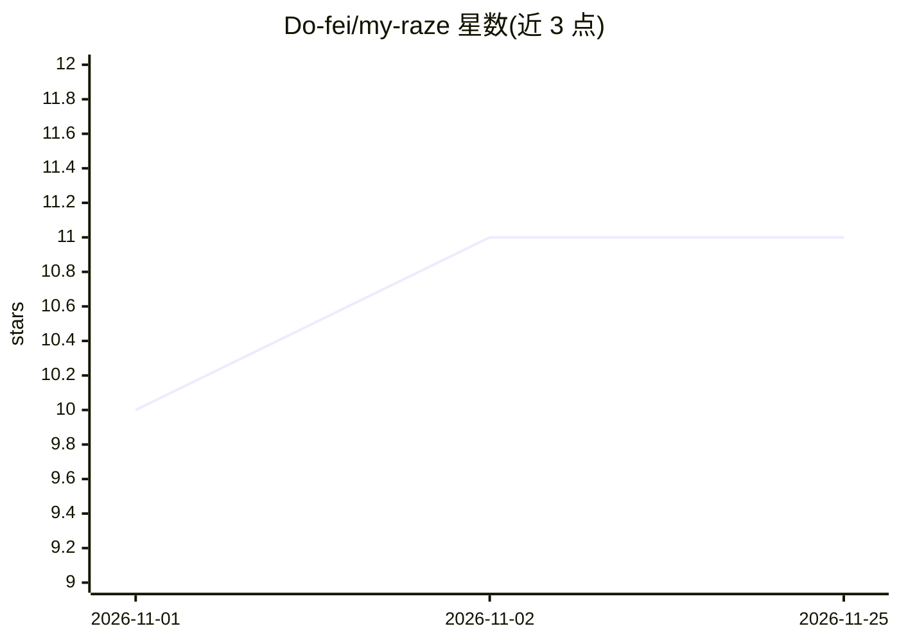

# Do-fei/my-raze

⭐ 11 · TypeScript · MIT · 推送 2026-09-05 · [GitHub](https://github.com/Do-fei/my-raze) · 个人维护 · 中文 README

**可自托管的 AI 虚拟女友应用：对话、场景自拍、语音与亲密度养成**

全栈 AI 陪伴 Web 应用，支持 PWA 安装。核心机制：OpenRouter 接入 500+ 模型驱动对话；fal.ai 基于参考图生成角色一致的场景自拍；Whisper 转写语音输入并支持多家 TTS 朗读；10 级亲密度系统控制解锁内容；自动提取长期记忆并可在界面中查看、置顶、删除。数据存储在自托管 MySQL 与本地卷或 S3，BYOK 密钥 AES-256-GCM 加密。提供 18+ 声明与 AI 身份披露，免费层每日配额 30 条消息、1 张自拍。

## 筛选速览

| 维度 | 判定 | 备注 |
|---|---|---|
| AI 角色 | `ai-native` | 本体是模型或模型工具 |
| 许可风险 | `permissive` | MIT |
| 部署形态 | `self-host` | docker 或自建部署 |
| 模型依赖 | locked-api |  |
| 硬件要求 | — | 无带数字的原话,不猜 |
| 安装摩擦 | `low` | 无编译、无系统依赖或容器化 |
| 成熟度 | — | 结构信号不足 |

## 能力要点

- OpenRouter 接入 500+ 模型，六套人格模板 + 四层提示词控制
- 参考图锁定角色外貌的场景自拍生成（fal.ai）
- 可编辑的长期记忆：提取、注入、置顶、删除
- 10 级亲密度系统与 Web Push 主动消息

## 适用场景

- 在自己服务器上部署私人 AI 陪伴应用
- 自带 API Key 使用对话与自拍功能
- 通过亲密度与记忆系统进行长线角色互动

## 场景标签

`聊天机器人` · 领域:对话与助手

## 证据(README 行号)

> L21: **My Raze** 是一款可自托管的全栈 AI 陪伴 Web 应用（支持 PWA 安装到手机桌面）。
> L119: |💬|**智能对话**|OpenRouter 接入 GPT-4o / Claude / Grok 等 500+ 模型；六套人格模板 + 四层提示词精细控制|
> L121: |🎙️|**语音互动**|按住说话 + Whisper 转写；浏览器 / ElevenLabs / Fish Audio 朗读；语音输入后可自动语音回复|

## 星数曲线

2026-11-01 10 → 2026-11-25 11（+1）

---
*卡片 v1 · prompt 1.4 · 生成 2026-11-19 · 置信度 high · 依据 README sha `e462793a0ba9` · [字段定义](../../DATASET.md)*
