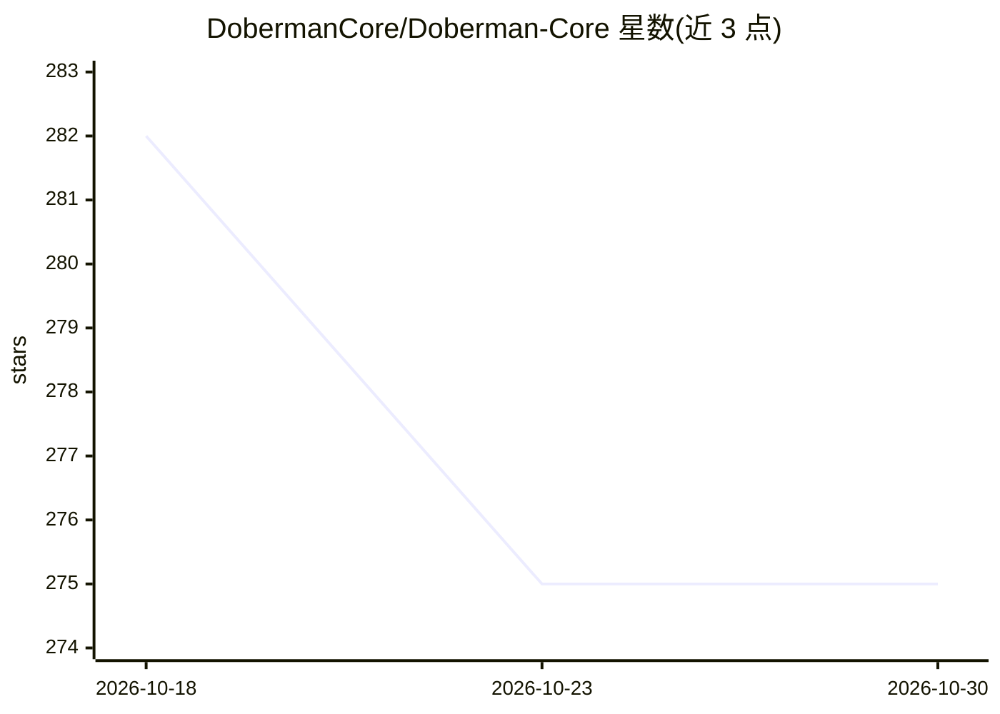

# DobermanCore/Doberman-Core

⭐ 275 · Python · Apache-2.0 · 推送 2026-10-29 · [GitHub](https://github.com/DobermanCore/Doberman-Core) · [官网](https://pypi.org/project/doberman-core/) · 组织维护

**AI 编程 agent 的运行时授权与防护代理：拦截危险工具调用**

面向 AI 编程 agent 的运行时防护层：通过 MCP 代理或宿主 hook 部署在 agent 与工具之间，对每次工具调用在执行前给出 PASS/AUTH/BLOCK 判定，并含模型推理前的 turn gate 提示注入预警。机制上采用 fail closed（不确定即拒绝）与 raise-only（策略只收紧不静默放宽，放宽需 TOTP/密码等凭证），支持 Claude Code、Codex、Cursor、OpenClaw 及任意 MCP 兼容 agent。以 pip 包提供，附 CLI、dashboard、基准评测与插件体系；Cursor hook 标注为 experimental。

## 筛选速览

| 维度 | 判定 | 备注 |
|---|---|---|
| AI 角色 | `ai-ecosystem` | LLM/agent 周边工具 |
| 许可风险 | `permissive` | Apache-2.0 |
| 部署形态 | `library` | 以包/库形式分发 |
| 模型依赖 | — | README 未给出锁定关系 |
| 硬件要求 | — | 无带数字的原话,不猜 |
| 安装摩擦 | `low` | 无编译、无系统依赖或容器化 |
| 成熟度 | `idea` | |

## 能力要点

- 每个工具调用执行前产出 PASS/AUTH/BLOCK 判定并记录审计日志
- fail closed 与 raise-only 两项保证，策略放宽需 TOTP/本地密码确认
- MCP 代理 + 宿主 hook 双接入方式，覆盖 Claude Code/Codex/Cursor/OpenClaw 等
- 含攻击绕过率与误拦截率基准 harness 及第三方规则插件入口

## 适用场景

- 防止编程 agent 执行 rm -rf、密钥外泄等危险操作
- 对 agent 敏感操作引入人工审批队列
- 审计 agent 全部工具调用的决策记录

## 场景标签

`网络安全` · 领域:学习与行业

## 证据(README 行号)

> L22: Doberman sits between the agent and its tools, through a transparent **MCP proxy** or **host hook** (MCP: Model Con
> L31: AI agent ──▶ Doberman ──▶ real tools (files, shell, MCP servers, APIs)
> L35: Works with Claude Code, Codex, OpenClaw, and any MCP-compatible agent. Cursor is guarded through its native hooks *

## 星数曲线

2026-10-18 282 → 2026-10-30 275（-7）

---
*卡片 v1 · prompt 1.4 · 生成 2026-10-22 · 置信度 mid · 依据 README sha `b4d6373e5d0a` · [字段定义](../../DATASET.md)*
