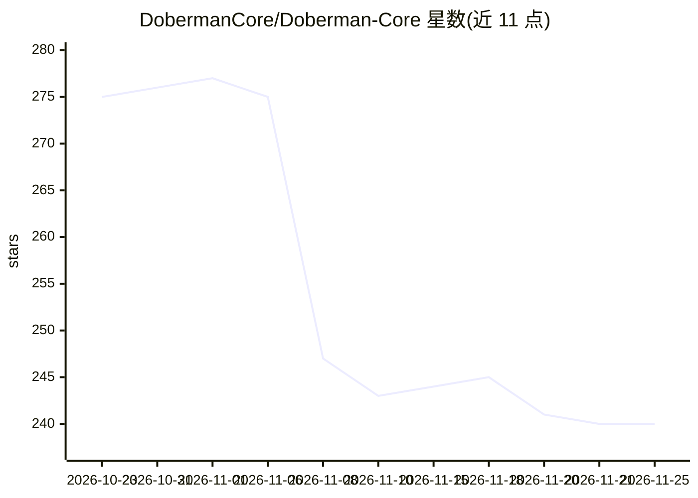

# DobermanCore/Doberman-Core

⭐ 240 · Python · Apache-2.0 · 推送 2026-11-19 · [GitHub](https://github.com/DobermanCore/Doberman-Core) · [官网](https://pypi.org/project/doberman-core/) · 组织维护

**AI 编程 agent 的运行时守卫：拦截危险工具调用**

部署在 agent 与其工具之间执行路径上的安全层，通过 MCP 代理或宿主 hook 对每次工具调用给出 PASS/AUTH/BLOCK 三种裁决，在动作执行前阻断危险操作（如 rm -rf、密钥外泄、越权推送）。两条核心保证：fail closed（不确定即拒绝，审批超时转为拒绝）与 raise-only（策略只能自动收紧，放宽需带 TOTP 或本地密码的审计化人工批准）。配套仪表盘、决策日志、turn gate 输入层检查与可复现的检测基准。以 Python CLI（pip 安装）提供，本地优先运行。

## 筛选速览

| 维度 | 判定 | 备注 |
|---|---|---|
| AI 角色 | `ai-ecosystem` | LLM/agent 周边工具 |
| 许可风险 | `permissive` | Apache-2.0 |
| 部署形态 | `library` | 以包/库形式分发 |
| 模型依赖 | — | README 未给出锁定关系 |
| 硬件要求 | — | 无带数字的原话,不猜 |
| 安装摩擦 | `low` | 无编译、无系统依赖或容器化 |
| 成熟度 | — | 结构信号不足 |

## 能力要点

- 每次工具调用给出唯一裁决：PASS 直通、AUTH 暂停待批、BLOCK 拦截
- fail closed 与 raise-only 两条可审计的安全保证，含审批超时兜底
- 通过 MCP 代理或宿主 hook 接入 Claude Code、Codex、OpenClaw 等
- turn gate 在模型推理前拦截 Tier-0 提示注入签名

## 适用场景

- 给本地运行的编程 agent 加一道工具调用审批与拦截层
- 防止 agent 执行 rm -rf 或外泄 API 密钥等破坏性动作
- 团队需要对 agent 高风险操作留审计日志并人工复核

## 场景标签

`网络安全` · 领域:学习与行业

## 证据(README 行号)

> L5: **Adaptive Authorization & Runtime Guardrails for AI Coding Agents**
> L22: Doberman sits between the agent and its tools, through a transparent **MCP proxy** or **host hook** (MCP: Model Con
> L35: Works with Claude Code, Codex, OpenClaw, and any MCP-compatible agent. Cursor is guarded through its native hooks *

## 星数曲线

2026-10-23 275 → 2026-11-25 240（-35）

---
*卡片 v1 · prompt 1.4 · 生成 2026-11-25 · 置信度 mid · 依据 README sha `62374c127ee1` · [字段定义](../../DATASET.md)*
