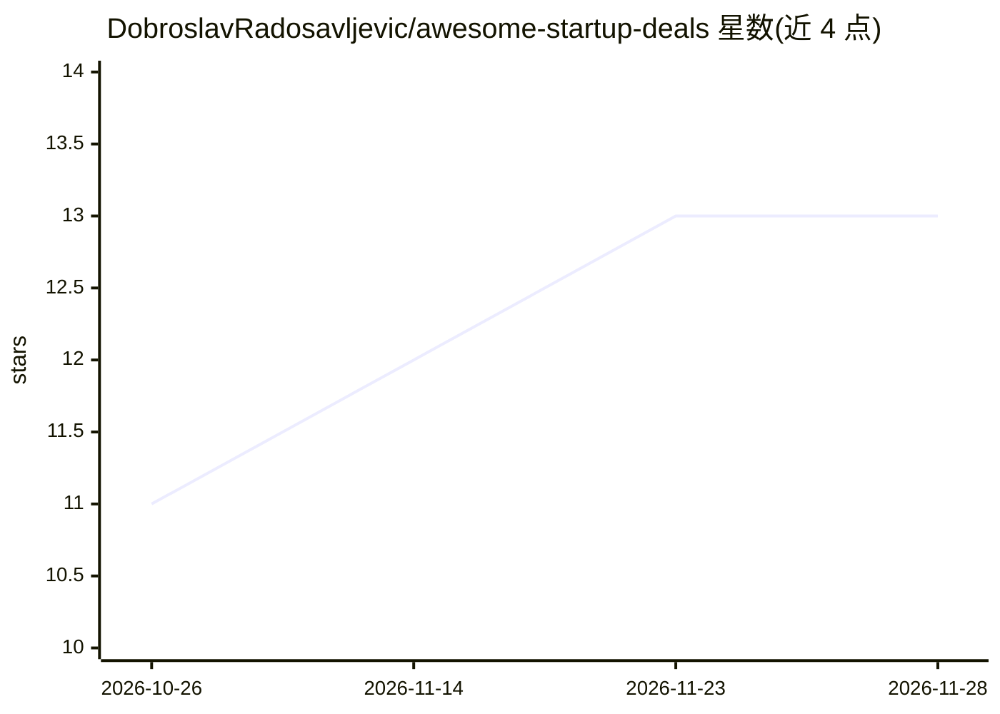

# DobroslavRadosavljevic/awesome-startup-deals

⭐ 13 · MIT · 推送 2026-10-27 · [GitHub](https://github.com/DobroslavRadosavljevic/awesome-startup-deals) · 个人维护

**为初创公司整理云与 SaaS 优惠/抵扣额度的策展清单**

按类别组织的初创优惠清单，收录云平台抵扣额度（AWS Activate、Google for Startups、阿里云等）、主机部署优惠、数据库与后端服务折扣等条目，每条列出提供方、优惠内容、申请资格与链接。数据由作者、社区及 AI 辅助收集整理，README 声明部分信息可能不完全准确，鼓励通过 pull request 提交修正更新。MIT 许可，接受社区贡献。

## 筛选速览

| 维度 | 判定 | 备注 |
|---|---|---|
| AI 角色 | `ai-knowledge` | 知识聚合/清单类 |
| 许可风险 | `permissive` | MIT |
| 部署形态 | `None` |  |
| 模型依赖 | — | README 未给出锁定关系 |
| 硬件要求 | — | 无带数字的原话,不猜 |
| 安装摩擦 | `low` | 无编译、无系统依赖或容器化 |
| 成熟度 | — | 结构信号不足 |

## 能力要点

- 按类别与提供方组织的创业优惠清单（云额度、SaaS 折扣、开发工具、商业服务）
- 每条含优惠金额、申请资格与申请链接
- MIT 许可、接受 PR 贡献
- 声明数据收集借助 AI，可能存在不准确信息

## 适用场景

- 初创公司查找可申请的云服务抵扣额度
- 对照申请资格筛选适用的创业扶持计划
- 融资阶段变化时检索对应层级的优惠

## 场景标签

`精选清单` · 领域:学习与行业

## 证据(README 行号)

> L3: > A curated list of awesome deals, discounts, and offers for startups and entrepreneurs
> L11: This collection of startup deals is curated by the author, the open source community, and with the assistance of AI

## 星数曲线

2026-10-26 11 → 2026-11-28 13（+2）

---
*卡片 v1 · prompt 1.4 · 生成 2026-11-18 · 置信度 high · 依据 README sha `ddb0d356b16d` · [字段定义](../../DATASET.md)*
