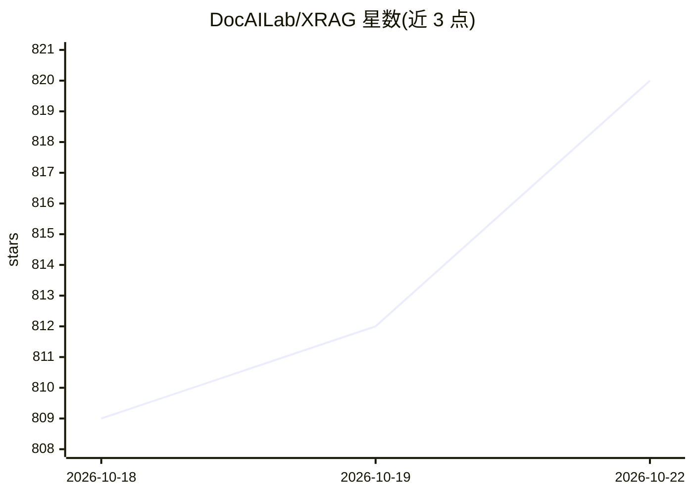

# DocAILab/XRAG

⭐ 820 · Python · Apache-2.0 · 推送 2026-10-19 · [GitHub](https://github.com/DocAILab/XRAG) · [官网](https://docailab.github.io/XRAG/) · 组织维护 · 中文 README

**RAG 核心组件基准评测框架（ICDE 2026 论文）**

面向先进检索增强生成（RAG）系统的评测框架：拆解各核心模块，评估检索质量、响应忠实度与答案正确性；支持 LLM 评测、深度评测与传统指标（F1、MRR、NDCG 等），内置 LlamaIndex 与 DeepEval 度量。提供模块化可插拔架构，覆盖 BM25/向量/树结构等多种检索方法，并通过顺序、条件、迭代等五类编排器实现 Agentic RAG（self-rag、adaptive-rag）。pip 安装，提供 CLI、WebUI 与 API 后端服务，可从文档文件夹生成 QA 对。

## 筛选速览

| 维度 | 判定 | 备注 |
|---|---|---|
| AI 角色 | `ai-ecosystem` | LLM/agent 周边工具 |
| 许可风险 | `permissive` | Apache-2.0 |
| 部署形态 | `library` | 以包/库形式分发 |
| 模型依赖 | local-ok | 支持本地模型 |
| 硬件要求 | — | 无带数字的原话,不猜 |
| 安装摩擦 | `low` | 无编译、无系统依赖或容器化 |
| 成熟度 | — | 结构信号不足 |

## 能力要点

- 多维度评测：传统指标（F1/EM/MRR/NDCG）+ LLM 指标（忠实度/相关性）+ 深度评测（幻觉/偏见）
- 五类编排器（sequential/conditional/iterative/parallel/hybrid）实现 Agentic RAG
- 模块化可插拔检索器/嵌入/LLM，支持 OpenAI 与 Qwen、LLaMA 等本地模型
- 提供 CLI、WebUI、API 后端服务与 QA 对自动生成

## 适用场景

- 评测 RAG 系统中不同检索与生成组件配置的性能
- 对比 BM25、向量、树结构等检索方法的效果
- 把 RAG 评测作为后端服务通过 HTTP API 调用

## 场景标签

`模型评测` `RAG` · 领域:评测与运维

## 证据(README 行号)

> L59: XRAG is a benchmarking framework designed to evaluate the foundational components of advanced Retrieval-Augmented G
> L64:  - Multiple evaluation dimensions: LLM-based evaluation, Deep evaluation, and traditional metrics

## 星数曲线

2026-10-18 809 → 2026-10-22 820（+11）

---
*卡片 v1 · prompt 1.4 · 生成 2026-10-21 · 置信度 high · 依据 README sha `14f13be19284` · [字段定义](../../DATASET.md)*
