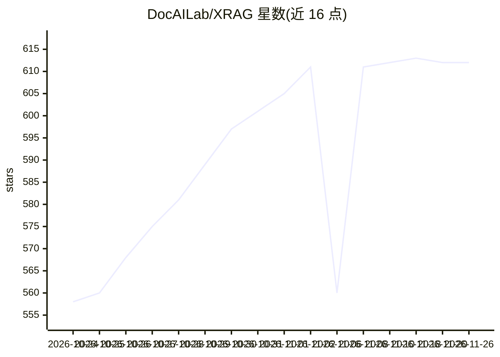

# DocAILab/XRAG

⭐ 612 · Python · Apache-2.0 · 推送 2026-11-01 · [GitHub](https://github.com/DocAILab/XRAG) · [官网](https://docailab.github.io/XRAG/) · 组织维护 · 中文 README

**面向研究者的 RAG 核心模块基准评测框架**

XRAG 是一个基准评测框架，用于评估高级 RAG 系统的基础组件，通过拆解各核心模块分析不同配置对整体性能的影响。内置 LlamaIndex、DeepEval 及自定义指标，覆盖检索质量、响应忠实度、答案正确性等多维评测；支持向量/BM25/混合/树状检索与五种 orchestrator 实现 agentic RAG。提供 xrag-cli 命令行、WebUI 与 API 后端服务，可从文档文件夹自动生成 QA 对。要求 Python 3.11+，LLM 通过 API key 配置。

## 筛选速览

| 维度 | 判定 | 备注 |
|---|---|---|
| AI 角色 | `ai-ecosystem` | LLM/agent 周边工具 |
| 许可风险 | `permissive` | Apache-2.0 |
| 部署形态 | `library` | 以包/库形式分发 |
| 模型依赖 | local-ok | 支持本地模型 |
| 硬件要求 | — | 无带数字的原话,不猜 |
| 安装摩擦 | `low` | 无编译、无系统依赖或容器化 |
| 成熟度 | — | 结构信号不足 |

## 能力要点

- 多维评测指标：传统指标（F1/EM/MRR/NDCG）、LLM 评估与深度评估（幻觉/偏见）
- 五种 orchestrator 组织 RAG 工作流，实现 self-rag、adaptive-rag 等 agentic 方法
- xrag-cli 提供 run/webui/api/generate 等子命令，支持配置覆盖
- 可从文档文件夹自动生成 QA 对用于评测

## 适用场景

- 对自建 RAG 系统的不同检索与生成组件配置做基准评测
- 为 RAG 数据集构建索引并交互式测试查询效果
- 从自有文档批量生成 QA 对作为评测数据
- 以 API 服务形式将 RAG 评测能力接入后端流程

## 场景标签

`RAG` `模型评测` · 领域:评测与运维

## 证据(README 行号)

> L61: XRAG is a benchmarking framework designed to evaluate the foundational components of advanced Retrieval-Augmented G
> L66:  - Multiple evaluation dimensions: LLM-based evaluation, Deep evaluation, and traditional metrics

## 星数曲线

2026-10-24 558 → 2026-11-26 612（+54）

---
*卡片 v1 · prompt 1.4 · 生成 2026-11-25 · 置信度 high · 依据 README sha `621777572a65` · [字段定义](../../DATASET.md)*
