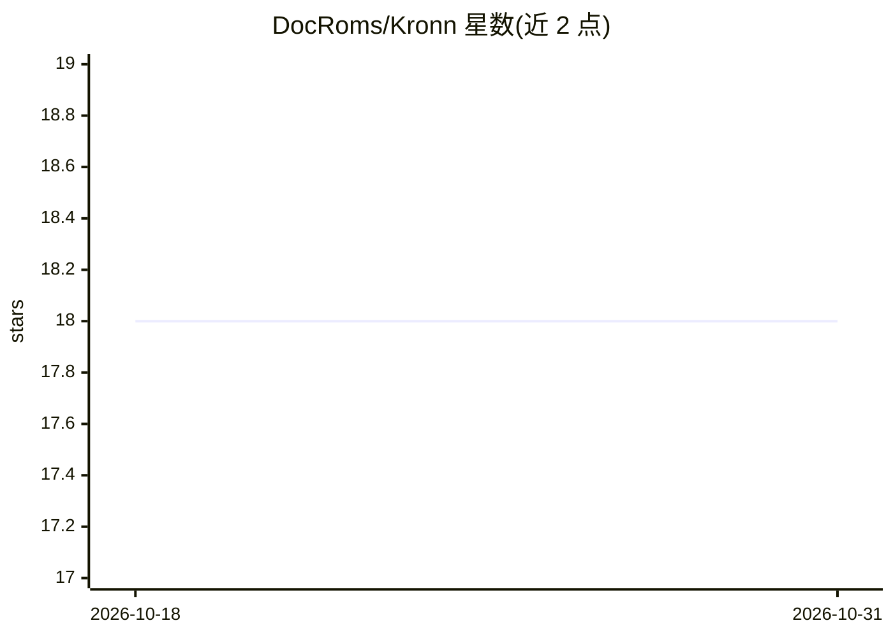

# DocRoms/Kronn

⭐ 18 · Rust · AGPL-3.0 · 推送 2026-10-30 · [GitHub](https://github.com/DocRoms/Kronn) · 个人维护 · 中文 README

**自托管 AI 编程 agent 控制面：统一运行多个 CLI agent 与本地模型**

面向使用多个 CLI 编程 agent（Claude Code、Codex、Gemini CLI、OpenCode 等）的开发者，用 Rust 后端 + React 前端构建的自托管控制面板。机制：共享 MCP 配置与加密密钥库、可复用 Quick Prompt 与批量扇出、多步确定性工作流（ApiCall/Exec/Notify 等零 token 步骤 + 小型 AI 提示）、compare-agents 并行对比验证提示、AI 文档审计。支持 Ollama 本地模型与 LiteLLM/OpenRouter 等 HTTP 提供方，自身不内置 LLM。提供桌面安装包、Docker 与源码三种部署方式。当前版本 0.15.1，pre-1.0，次版本间存在破坏性变更。

## 筛选速览

| 维度 | 判定 | 备注 |
|---|---|---|
| AI 角色 | `ai-ecosystem` | LLM/agent 周边工具 |
| 许可风险 | `viral` | AGPL-3.0 |
| 部署形态 | `self-host` | docker 或自建部署 |
| 模型依赖 | local-ok | 支持本地模型 |
| 硬件要求 | — | 无带数字的原话,不猜 |
| 安装摩擦 | `low` | 无编译、无系统依赖或容器化 |
| 成熟度 | `idea` | |

## 能力要点

- 统一仪表盘运行多个 CLI agent，共享 MCP、密钥与项目上下文
- 工作流分解：确定性代码步骤零 token，AI 仅用于推理步骤
- compare-agents 多 agent 并行对比验证提示
- Ollama 一级支持，本地模型路由到 localhost:11434，零 API 成本

## 适用场景

- 在多个终端管理 Claude Code / Codex / Gemini CLI，统一 MCP 配置
- 把同一提示批量扇出到 30 个工单并人工审批后落地
- 通过 Ollama 完全本地运行 Llama/Qwen，代码不出本机

## 场景标签

`编码 Agent` `多智能体` `提示工程` `工作流自动化` · 领域:Agent 开发

## 证据(README 行号)

> L66: Kronn is a **self-hosted control plane for AI coding agents**: Claude Code, Codex, OpenCode, Vibe, Gemini CLI, Kiro
> L91: **Prerequisite:** at least one local CLI agent, Ollama for fully-local models, or an existing LiteLLM proxy. Kronn 

## 星数曲线

2026-10-18 18 → 2026-10-31 18（+0）

---
*卡片 v1 · prompt 1.4 · 生成 2026-10-29 · 置信度 high · 依据 README sha `5ec780102bf8` · [字段定义](../../DATASET.md)*
