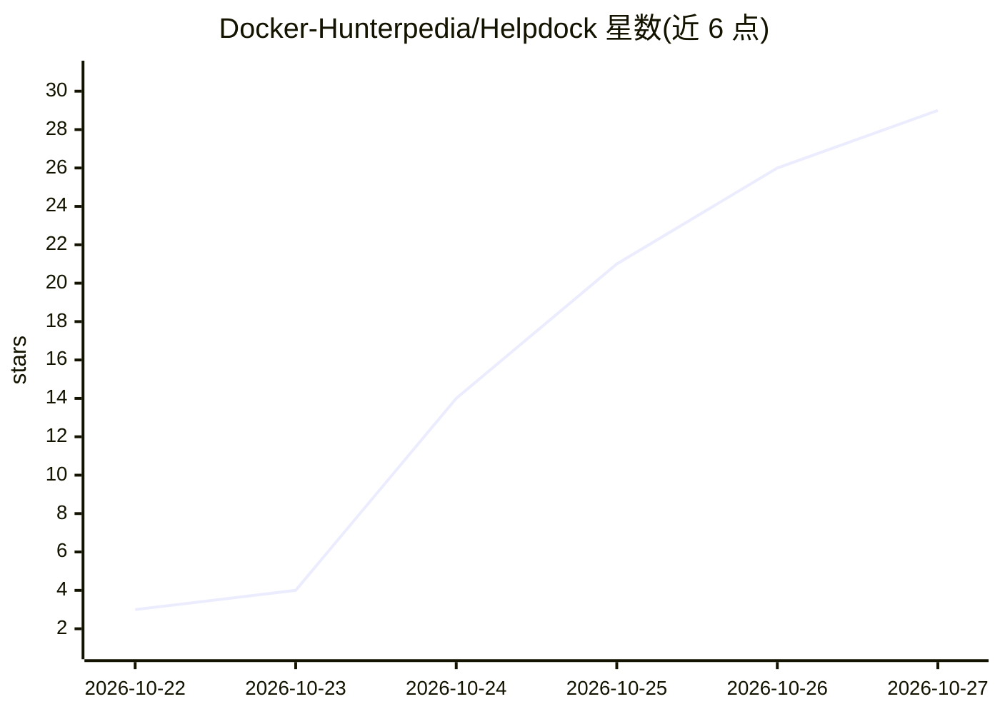

# Docker-Hunterpedia/Helpdock

⭐ 29 · TypeScript · AGPL-3.0 · 推送 2026-10-26 · [GitHub](https://github.com/Docker-Hunterpedia/Helpdock) · [官网](https://helpdock.oday-bakkour.com) · 组织维护

**自托管多品牌客服平台：工单、帮助中心、在线聊天与知识库接地 AI**

开源客服支持平台，单次 Docker Compose 部署服务多个品牌：工单与 SLA、部门与工作流规则、帮助中心（每品牌独立域名）、嵌入式聊天挂件，渠道覆盖邮件、Telegram、WhatsApp/Messenger/Instagram、Web 表单与 REST API。AI 部分为接地助手：仅依据品牌知识库（文章、PDF/DOCX、抓取网站、Notion/Google Drive）回答并引用来源，无法回答时转人工；支持 pi-ai 所列提供商或任意 OpenAI 兼容服务器（如 Ollama、vLLM）。另有座席辅助、AI 分诊、语音转写、PII 脱敏与预算控制。管理员界面、帮助中心与挂件均提供英文和阿拉伯文（含从右到左布局），品牌隔离由 Postgres 行级安全策略强制实施。提供 Zendesk/Freshdesk/Zoho Desk 导入器。AGPL-3.0 许可。

## 筛选速览

| 维度 | 判定 | 备注 |
|---|---|---|
| AI 角色 | `ai-enhanced` | 去掉 AI 部分产品仍成立 |
| 许可风险 | `viral` | AGPL-3.0 |
| 部署形态 | `desktop` | 安装包/桌面程序 |
| 模型依赖 | local-ok | 支持本地模型 |
| 硬件要求 | — | 无带数字的原话,不猜 |
| 安装摩擦 | `low` | 无编译、无系统依赖或容器化 |
| 成熟度 | — | 结构信号不足 |

## 能力要点

- 单部署多品牌，Postgres 行级安全强制品牌隔离
- 接地 AI 仅依据品牌知识库回答、引用来源并在无答案时转人工
- 邮件/Telegram/Meta 渠道/聊天挂件/Web 表单/REST API 汇入同一工单队列
- 英阿双语界面，含从右到左布局；提供 Zendesk/Freshdesk/Zoho Desk 迁移导入器

## 适用场景

- 在自己服务器上搭建多品牌客服工单与帮助中心系统
- 让 AI 仅基于自家知识库回答客户提问并在无法回答时转人工
- 从 Zendesk、Freshdesk 或 Zoho Desk 迁移历史数据
- 为不同品牌配置独立域名、挂件主题与 AI 知识库

## 场景标签

`知识库管理` `文档问答` `聊天机器人` · 领域:对话与助手

## 证据(README 行号)

> L3: **Self-hosted customer support: ticketing, a help center, a live chat widget and grounded AI, in one deploy that ser
> L32: - **AI that stays inside your knowledge.** The assistant answers only from the brand's knowledge base, cites its so
> L72: - **Answers only from your knowledge**: help center articles, uploaded PDF and DOCX files, crawled websites, Notion

## 星数曲线

2026-10-22 3 → 2026-10-27 29（+26）

---
*卡片 v1 · prompt 1.4 · 生成 2026-10-26 · 置信度 mid · 依据 README sha `4dff2ea555b5` · [字段定义](../../DATASET.md)*
