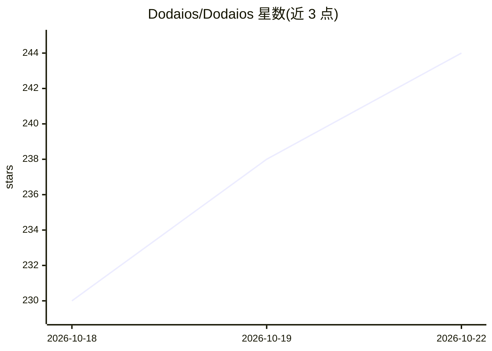

# Dodaios/Dodaios

⭐ 244 · Python · Apache-2.0 · 推送 2026-10-21 · [GitHub](https://github.com/Dodaios/Dodaios) · [官网](https://dodaios.ai) · 个人维护 · 中文 README

**本地开源桌面 Agent OS：语音/聊天调度编码 Agent 与应用**

面向桌面用户的开源 agent 操作系统（原 Personal Jarvis），运行于 Windows/macOS/Linux 或无屏服务器。主 Agent 按语音或聊天指令规划并分派任务，Agentic IDE 可在多终端窗格并行运行 Claude Code、Codex 等 9 种编码 Agent，支持 Git worktree、PR/CI 面板、定时例程、本地记忆 wiki、计算机使用（点击/输入/读取屏幕）、40+ 插件与 MCP。语音含唤醒词、对话、听写与电话，可离线。每步操作经四级风险检查（safe/monitor/ask/block）需批准。需一个 API key、订阅或本地模型，无需 GPU。一行脚本安装或 pip 安装，Apache 2.0。

## 筛选速览

| 维度 | 判定 | 备注 |
|---|---|---|
| AI 角色 | `ai-native` | 本体是模型或模型工具 |
| 许可风险 | `permissive` | Apache-2.0 |
| 部署形态 | `library` | 以包/库形式分发 |
| 模型依赖 | local-ok | 支持本地模型 |
| 硬件要求 | — | 无带数字的原话,不猜 |
| 安装摩擦 | `low` | 无编译、无系统依赖或容器化 |
| 成熟度 | — | 结构信号不足 |

## 能力要点

- Agentic IDE 并行运行 9 种编码 Agent（各自分支/worktree，呼号指挥）
- 四级风险检查与操作记录，密钥存于系统凭证库
- 语音唤醒、对话、听写、电话，语音识别与语音可全离线
- 本地记忆 wiki 供 Agent 读写引用；40+ 插件与 MCP 集成

## 适用场景

- 用一句话让多个编码 Agent 并行完成编码、审查到合并 PR 的流程
- 语音唤醒本机助手，操作桌面、浏览器与应用
- 为不同任务创建专属 Agent 并按定时例程自动执行

## 场景标签

`编码 Agent` `语音 Agent` `AI 助手` `GUI 自动化` · 领域:效率与自动化

## 证据(README 行号)

> L8:  Dodaios is an open-source agent OS for your desktop.
> L9:  It is the layer between you and your AI agents: it runs them, remembers for them, connects their tools and keeps yo
> L53: 1. **Plan with the lead agent.** Say what you want, by voice or in chat. The lead agent asks what it needs and hand

## 星数曲线

2026-10-18 230 → 2026-10-22 244（+14）

---
*卡片 v1 · prompt 1.4 · 生成 2026-10-22 · 置信度 high · 依据 README sha `1d5ebb1c1e4f` · [字段定义](../../DATASET.md)*
