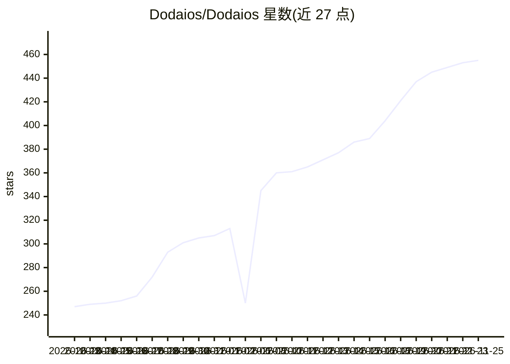

# Dodaios/Dodaios

⭐ 455 · Python · MIT · 推送 2026-11-24 · [GitHub](https://github.com/Dodaios/Dodaios) · [官网](https://dodaios.ai) · 组织维护

**统一编排多个编程 Agent 的本地桌面工作台**

桌面应用形式的元编排器：用户与一个助手对话，由它向 Claude Code、Codex 等编程 CLI/IDE/本地 Agent 分发、监控并同步工程任务。支持语音交互（助手名即唤醒词）、MCP，本地运行、使用用户自己的计划与 API key。安装器自建 Python 环境并提供启动器；首次启动需命名助手、连接一个模型；编程工作需另装至少一个编程 Agent 并登录。

## 筛选速览

| 维度 | 判定 | 备注 |
|---|---|---|
| AI 角色 | `ai-ecosystem` | LLM/agent 周边工具 |
| 许可风险 | `permissive` | MIT |
| 部署形态 | `desktop` | 安装包/桌面程序 |
| 模型依赖 | — | README 未给出锁定关系 |
| 硬件要求 | — | 无带数字的原话,不猜 |
| 安装摩擦 | `low` | 无编译、无系统依赖或容器化 |
| 成熟度 | — | 结构信号不足 |

## 能力要点

- 单一聊天界面编排多个编程 Agent（Claude Code、Codex 等）
- 自动分发、监控并同步跨 Agent 的复杂工程任务
- 语音交互，助手名即唤醒词
- 本地运行，使用用户自有的计划与密钥，MIT 许可

## 适用场景

- 同时使用多个编程 CLI 时统一调度任务
- 通过语音与一个助手对话驱动多个编程 Agent
- 在本地以自有 API key 管理编码助手工作流

## 场景标签

 · 领域:开发工具/Agent 编排

## 证据(README 行号)

> L9:  The meta-agent that sits above all your coding agents. Talk to one orchestrator in a single chat while Dodaios auto
> L52: The installer sets up its own Python environment, adds a launcher and opens

## 星数曲线

2026-10-23 247 → 2026-11-25 455（+208）

---
*卡片 v1 · prompt 1.4 · 生成 2026-11-25 · 置信度 high · 依据 README sha `9110b1f9aa9a` · [字段定义](../../DATASET.md)*
