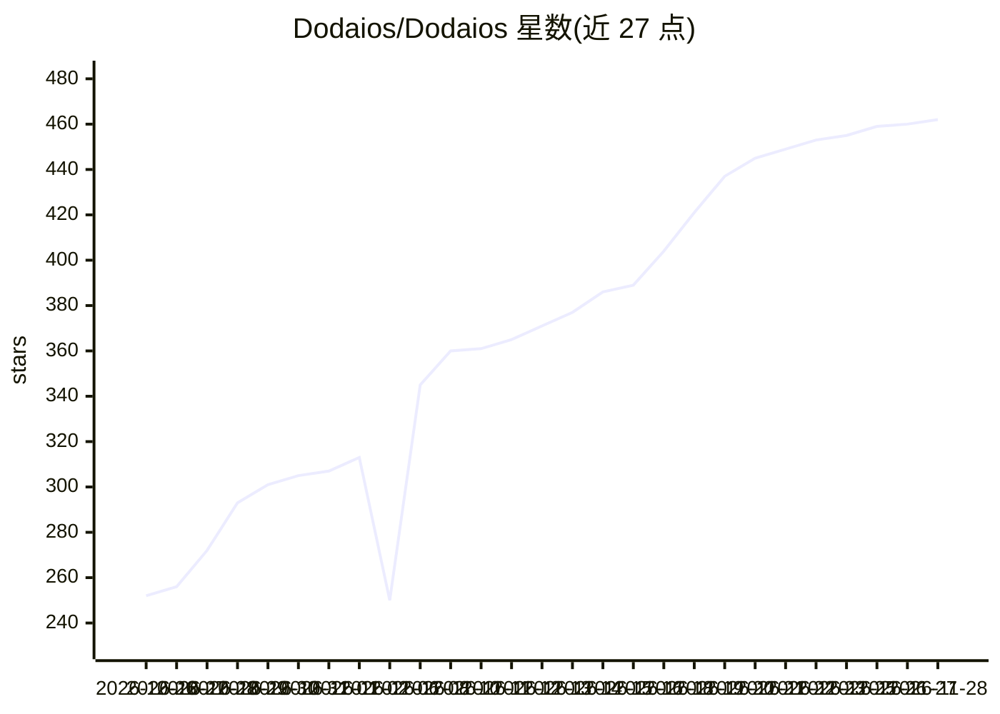

# Dodaios/Dodaios

⭐ 462 · Python · Apache-2.0 · 推送 2026-11-27 · [GitHub](https://github.com/Dodaios/Dodaios) · [官网](https://dodaios.ai) · 组织维护 · 中文 README

**在本地桌面统一管理多个编码 agent 的 AI 助手工作台**

Dodaios（前身为 Personal Jarvis）是一个开源桌面应用，将 Claude Code、Codex 等多个编码 agent 并行放在一个工作区内，由一个助手统一运行；支持语音交互（唤醒词即助手名）、文档与 computer-use 能力，声明可自我改进。本地运行，使用用户自己的模型计划与 API key，采用 MIT 许可。安装脚本会自建 Python 环境并添加启动器；编码工作需至少安装一个编码 agent 并登录。

## 筛选速览

| 维度 | 判定 | 备注 |
|---|---|---|
| AI 角色 | `ai-enhanced` | 去掉 AI 部分产品仍成立 |
| 许可风险 | `permissive` | Apache-2.0 |
| 部署形态 | `desktop` | 安装包/桌面程序 |
| 模型依赖 | — | README 未给出锁定关系 |
| 硬件要求 | — | 无带数字的原话,不猜 |
| 安装摩擦 | `low` | 无编译、无系统依赖或容器化 |
| 成熟度 | — | 结构信号不足 |

## 能力要点

- 并排管理 Claude Code、Codex 等多个编码 agent
- 一个助手统一运行各 agent，支持语音与唤醒词
- 本地优先，使用用户自己的计划与 API key，MIT 许可
- 提供 macOS/Linux 安装脚本、Windows PowerShell 安装脚本及桌面安装包

## 适用场景

- 在同一工作区内并行使用多个编码 agent 写码
- 通过语音与助手交互来驱动编码任务
- 本地管理自己 key 下的 AI 编码工作流

## 场景标签

`编码 Agent` `AI 助手` · 领域:编码与开发

## 证据(README 行号)

> L55: coding work, install at least one coding agent, such as Claude Code or Codex,
> L9:  One self-improving AI agent that manages them all.

## 星数曲线

2026-10-26 252 → 2026-11-28 462（+210）

---
*卡片 v1 · prompt 1.4 · 生成 2026-11-26 · 置信度 high · 依据 README sha `f1177fcc23f4` · [字段定义](../../DATASET.md)*
